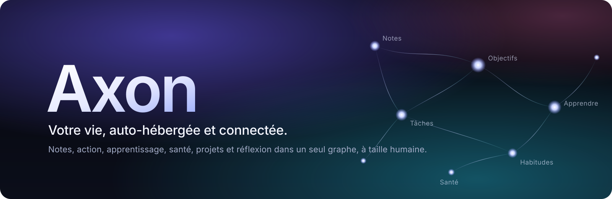

<p align="center"></p>

<p align="center">
  
  
  
  
</p>

<p align="center"><a href="README.md">English</a> · <strong>Français</strong></p>

<p align="center"><b>Notes, tâches, habitudes, apprentissage, santé et projets dans un seul graphe qui vous appartient.</b><br>
Auto-hébergé, privé par défaut, utile sans IA, et chaque changement proposé par une IA attend votre accord.</p>

[](web/static/teaser/axon.mp4)

<p align="center"><a href="web/static/teaser/axon.mp4">Voir la bande-annonce</a> · <a href="https://github.com/thoutmose/axon/releases/download/v1.0.0/axon-trailer-4k.mp4">en 4K</a> · <a href="https://axon.thoutmose.me">Essayer la démo</a></p>

## Ce que fait Axon

| Domaine | Points forts |
|---|---|
| **Second cerveau** | Notes Markdown avec wikiliens, rétroliens, maths, dessins et images ; un graphe de connaissances calculé sur votre serveur ; synchronisation dans les deux sens avec un coffre à la Obsidian. |
| **Action** | Tâches avec vues GTD et ajout rapide, projets Kanban, agendas en entrée et en sortie, rappels, revue hebdomadaire et sessions de concentration en musique. |
| **Progression** | Atomic Habits, objectifs et jalons, une feuille de route d’ingénieur en 47 domaines avec ses certifications, un radar de compétences et un journal de décisions. |
| **Apprentissage** | Cartes FSRS synchronisées avec Anki, rappel libre, palais de mémoire, journal de pratique, et une veille technologique avec son graphe d’actualités et son podcast. |
| **Vie** | Films, séries, livres et jeux ; budget et épargne ; eau, caféine, repas, entraînement et journal quotidien, chacun sous son propre consentement. |
| **Agents** | Treize agents et Jarvis sur le fournisseur de votre choix, modèle local compris ; ils proposent, vous décidez. |

La liste complète, avec captures d’écran, est dans **[doc/features.fr.md](doc/features.fr.md)**.

## Principes

1. **Vos données vous appartiennent.** Tout s’exporte dans des formats ouverts ; l’effacement est vérifié.
2. **Privé par défaut.** Le consentement est explicite, par finalité, et révocable.
3. **Les agents proposent, les personnes décident.** Aucun changement d’IA ne s’applique sans accord.
4. **Fonctionne sans IA.** Chaque fonctionnalité reste utile sans agents ni API externes.
5. **Reprendre, pas punir.** Un jour manqué ramène sur le chemin, jamais à la honte.

## Démarrage rapide

Il vous faut Docker Engine avec Compose v2.

```bash
git clone https://github.com/thoutmose/axon.git
cd axon
cp .env.example .env
docker compose up -d --build --wait
docker compose exec api axon migrate up
```

Ouvrez <http://localhost:3000> et créez le premier compte. Pour découvrir Axon avec des données d’exemple, mettez `AXON_DEMO=1` dans `.env`, redémarrez, lancez `docker compose exec api axon demo reset` et appuyez sur **Essayer la démo**.

Pour un vrai serveur, suivez le **[guide d’installation](doc/install.md)**, puis **[votre premier après-midi](doc/getting-started.fr.md)**.

## Documentation

| Guide | Contenu |
|---|---|
| [Installation](doc/install.md) · [Mise à jour](doc/upgrading.md) | Faire tourner Axon sur votre machine, HTTPS, sauvegardes, et passage d’une version à l’autre. |
| [Guide d’utilisation](doc/user-guide.md) | Chaque page, comment s’en servir et ce qu’elle conserve. |
| [Architecture](doc/architecture.fr.md) | Diagrammes, pile technique, matériel, configuration et sécurité. |
| [Exploitation](doc/operations.md) · [Procédures](doc/runbooks.md) | Déploiement, supervision, restauration et incidents. |
| [Confidentialité](doc/privacy.md) · [Sécurité](SECURITY.md) | Ce qui est collecté, où cela va, et comment signaler une vulnérabilité. |
| [Décisions](doc/adr/) · [Journal des versions](CHANGELOG.md) | Pourquoi Axon est construit ainsi, et ce qui a changé. |

L’API est décrite en OpenAPI 3.1 sur `/api/v1/openapi.yaml` ([source](api/openapi/openapi.yaml)), avec une interface Swagger sur `/api-docs/`.

## Construit avec

Go et chi, SvelteKit et TypeScript, PostgreSQL 16 avec pgvector, et Caddy, sur une seule machine avec Docker Compose. Deux vCPU et 4 Go de mémoire suffisent ; l’API sert 700 requêtes par seconde sur un petit serveur.

## Contribuer

Les contributions qui renforcent l’autonomie des personnes, l’accessibilité, la confidentialité ou la maintenabilité sont bienvenues. Lisez [CONTRIBUTING.md](CONTRIBUTING.md) et le [code de conduite](CODE_OF_CONDUCT.md), et lancez `make check` avant d’ouvrir une pull request. Signalez les vulnérabilités en privé comme l’indique [SECURITY.md](SECURITY.md).

## Licence

[AGPL-3.0-or-later](LICENSE). Les données de catalogue viennent d’Open Library, TMDB, Open Food Facts, USDA FoodData Central et Open English WordNet selon leurs propres conditions ; ce produit utilise l’API TMDB sans être approuvé ni certifié par TMDB.

> [!NOTE]
> Axon n’est ni un dispositif médical ni un thérapeute. Les résultats de santé et de coaching sont informatifs.

---

<p align="center"><sub>Axon — construire une vie que l’on comprend, un petit lien à la fois.</sub></p>
