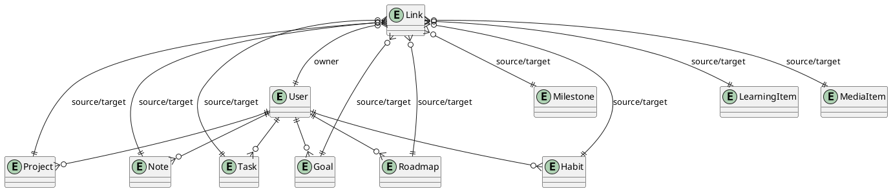
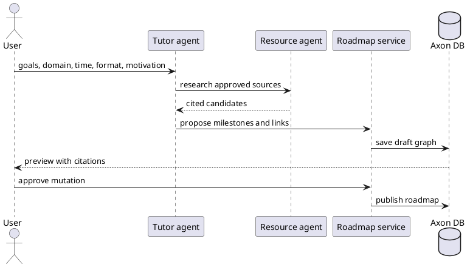
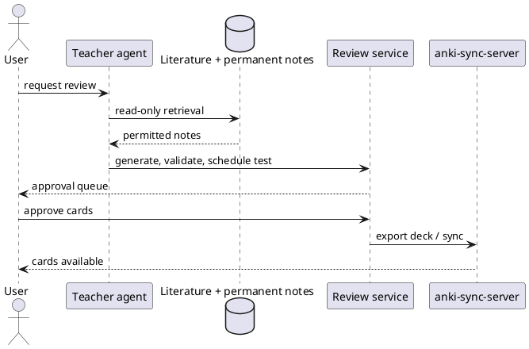
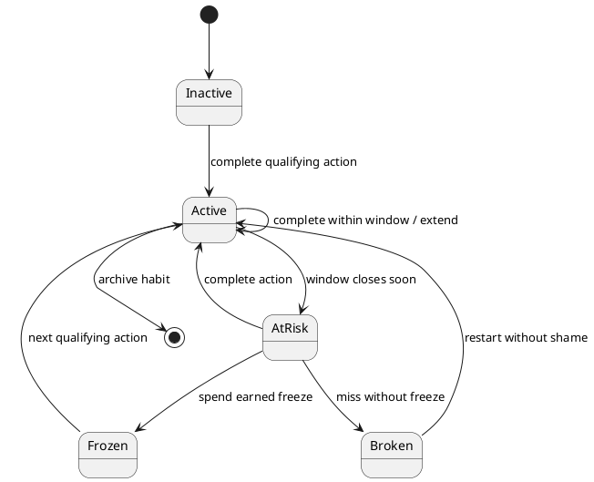
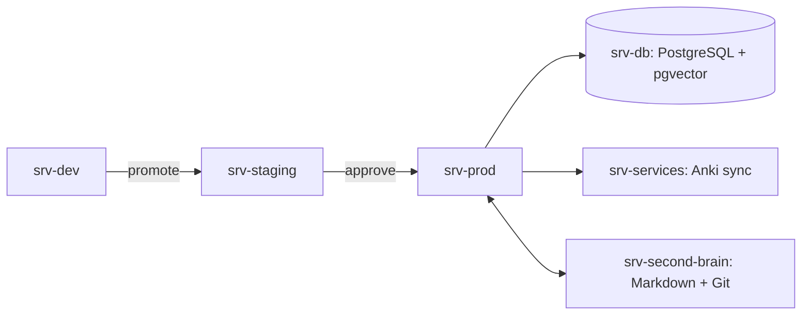
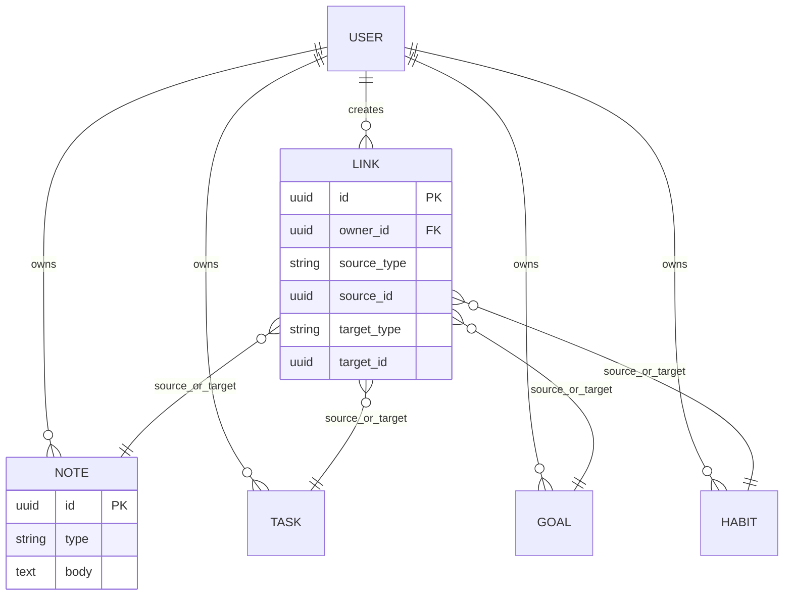

<p align="center">
  
  
  
</p>

<h1 align="center">Axon</h1>

<p align="center"><strong>Votre vie, auto-hébergée et connectée.</strong><br>Notes, action, apprentissage, santé, projets et réflexion dans un seul graphe, à taille humaine.</p>

<p align="center"><a href="README.md">English</a> · <strong>Français</strong></p>

> [!NOTE]
> Axon est en développement actif. Les fonctionnalités marquées ✅ marchent aujourd’hui ; les autres sont prévues, dans l’ordre donné par la [feuille de route](#feuille-de-route). Axon n’est ni un dispositif médical, ni un thérapeute, ni une promesse de mise en production.

## Sommaire

- [Pourquoi Axon ?](#pourquoi-axon-)
- [Fonctionnalités](#fonctionnalités)
- [Architecture](#architecture)
- [Pile technique](#pile-technique)
- [Matériel](#matériel-requis)
- [Démarrage rapide](#démarrage-rapide)
- [Configuration](#configuration)
- [Sécurité et RGPD](#sécurité-et-rgpd)
- [Agents IA](#agents-ia)
- [Gamification](#gamification)
- [Développement](#méthode-de-développement)
- [Tests et exploitation](#tests-et-exploitation)
- [Feuille de route](#feuille-de-route)
- [Contribuer](#contribuer)
- [Licence et remerciements](#licence-et-remerciements)

## Pourquoi Axon ?

Axon rassemble ce qui est d’habitude éparpillé entre applications de notes, listes de tâches, suivis, cours et tableurs. Son centre n’est ni un fil d’actualité ni un compteur de séries : c’est un graphe qui vous appartient, fait de vos engagements, de vos connaissances et de vos preuves. L’auto-hébergement, l’export, le consentement explicite et l’automatisation réversible sont des exigences de premier rang.

> [!WARNING]
> N’y saisissez ni urgence médicale, ni secret, ni données personnelles d’une autre personne. Les conseils des coachs sont informatifs et demandent le jugement d’un professionnel qualifié.

### Principes de fonctionnement

1. **Vos données vous appartiennent.** Tout s’exporte dans des formats ouverts ; l’effacement est vérifié, pas seulement mis en file d’attente.
2. **Privé par défaut.** Le consentement est explicite, par finalité, et révocable.
3. **Les agents proposent, les personnes décident.** Aucune modification produite par une IA ne s’applique sans approbation.
4. **Fonctionne sans IA.** Chaque fonctionnalité reste utile avec les agents et les API externes désactivés.
5. **Réversible plutôt qu’astucieux.** Des actions explicites et réversibles, et une technologie éprouvée.
6. **Reprendre, pas punir.** Un jour manqué ramène sur le chemin, jamais à la honte.
7. **Exploitable par d’autres.** Avec la documentation, n’importe qui peut le faire tourner, l’observer et le restaurer.

## Fonctionnalités

### 🧠 Second cerveau et Zettelkasten
- ✅ Un espace de notes : arborescence de dossiers, éditeur Markdown avec aperçu en direct, `[[liens wiki]]` avec suggestions, rétroliens et mentions, étiquettes, encadrés, tableaux, notes quotidiennes, modèles et centre de commandes (Ctrl+K).
- ✅ Dossiers PARA et notes Zettelkasten, import et export Markdown.
- ✅ Synchronisation bidirectionnelle avec le coffre `~/SecondBrain` (Git), qui garde les deux versions en cas de conflit.
- ✅ Raccourcis Vim dans l’éditeur de notes (en option), et raccourcis clavier partout : `?` pour la liste, `g` puis une lettre pour aller à une page.
- ✅ Synchronisation en direct avec votre coffre Markdown : ajoutez, modifiez, renommez ou supprimez un fichier et la note suit en quelques secondes, et inversement ; les modèles du coffre apparaissent dans Axon.
- ✅ Un explorateur de connaissances (Notes → Explorer) : filtres par PARA, type Zettelkasten, étiquette, texte, date ou notes non reliées ; graphiques des notes dans le temps, par PARA et par type, des étiquettes et des mots-clés partagés ; et un graphe de connaissances qui ajoute à vos liens des relations NLP locales (entités partagées, mots-clés distinctifs, synonymes anglais et français, formulations proches), chacune expliquant pourquoi elle existe. Aucun fournisseur d’IA n’est utilisé.

### ✅ Action et exécution
- ✅ Des tâches avec les vues Aujourd’hui, semaine et GTD (boîte de réception, prochaines actions, en attente, un jour peut-être), contextes, récurrence, capture en une touche et bilans quotidiens.
- ✅ Des projets avec tableaux Kanban (utilisables au clavier, limites de travail en cours), epics, tickets, sous-tâches et documentation de projet ; les tâches s’ouvrent sur un tableau GTD, avec un Kanban à un clic ; le calendrier s’ouvre sur une grille mensuelle.
- ✅ Pages Domaines, Ressources et Archives (PARA), et des modèles pour chaque type de note, projet, domaine, ressource, objectif, jalon et habitude, conservés comme fichiers dans votre coffre.
- ✅ Un tableau de bord Aujourd’hui avec des indicateurs définis, un calendrier et des flux iCal.
- ✅ Un tableau de bord sur Aujourd’hui : indicateurs comparés à la période précédente, graphiques d’activité quotidienne et sur 12 mois, tableaux de ce qui demande votre attention, et un réseau de vos compétences techniques et humaines relié aux objectifs, projets et notes.
- ✅ Sessions Pomodoro (25/5 × 3 puis 15 minutes de pause longue par défaut, tout est réglable, autant de sessions que voulu) liées à la tâche, au projet, à la compétence ou à la note travaillée, avec le temps de concentration sur le tableau de bord, une série quotidienne, des sons de concentration générés dans le navigateur (bruit, pluie) et vos propres liens de musique par activité.
- ✅ Finances personnelles dans l’esprit de Firefly III : comptes d’actifs et de passifs avec soldes, revenus, dépenses et virements (jamais comptés comme dépenses), catégories avec budgets mensuels, étiquettes, opérations récurrentes, règles de catégorisation, import CSV des relevés bancaires sans doublons, et rapports (flux mensuels, dépenses par catégorie, taux d’épargne, patrimoine net). Les montants sont des centimes entiers exacts ; les données financières restent hors de la recherche et des agents, et figurent dans votre export.

### 🌱 Habitudes, objectifs et parcours
- ✅ Des habitudes conçues avec *Atomic Habits* de James Clear : créer de bonnes habitudes (évidentes, attrayantes, faciles, satisfaisantes) ou en perdre de mauvaises (invisibles, repoussantes, difficiles, insatisfaisantes), enchaînement (« Après…, je… »), intentions de mise en œuvre (« Je… à… à/dans… »), une identité pour laquelle chaque bilan vote, contrats d’habitude, tableau des habitudes, versions de deux minutes et invitations bienveillantes à reprendre.
- ✅ Objectifs et jalons reliés aux tâches, notes, habitudes, projets et parcours, avec une progression expliquée et une revue hebdomadaire.
- ✅ Des parcours d’apprentissage créés à la main, importés d’OSSU ou tirés de la bibliothèque d’Axon : 24 domaines avec les livres, articles, cours universitaires, formations et chaînes les plus recommandés, de l’informatique et des maths à Kubernetes, au MLOps et à la sécurité. Chacun s’affiche en liste ou en graphe de compétences par niveaux.
- ✅ Une évaluation des compétences avant de commencer : votre situation, vos objectifs et quelques questions par domaine donnent un niveau expliqué, et les parcours démarrent à votre niveau.
- ✅ Un agent Tuteur qui vous interroge puis rédige un parcours dont chaque compétence cite sa source, et un agent Ressources qui trouve de quoi apprendre. Les deux attendent votre approbation.
- ✅ Reliez n’importe quel élément à n’importe quel autre, là où il s’affiche.

### 📚 Apprentissage et médias
- ✅ Des cartes mémoire illustrées à consulter, ajouter, modifier et supprimer, révisées avec FSRS-5 (le planificateur d’Anki, vérifié sur son implémentation de référence), des tests d’entraînement, et un agent Enseignant qui rédige des questions de récupération à partir de vos notes de lecture et permanentes, soumises à votre approbation.
- ✅ Paquets Anki (.apkg) par paquet de cartes, images comprises, et synchronisation automatique avec votre propre `anki-sync-server` (par exemple sur `srv-services`), à la demande ou dès que vous approuvez les cartes de l’Enseignant ; les cartes présentes seulement dans Anki ne sont jamais supprimées.
- ✅ Films, séries et livres : à voir ou à lire, en cours, terminés ou abandonnés, avec une note sur 10, la progression en pages, épisodes ou minutes, et une critique. Une fois les recherches autorisées (elles envoient le titre saisi), les livres viennent d’Open Library, et les films et séries de TMDB si le serveur a une clé ; tout peut s’ajouter à la main. Les couvertures sont copiées dans Axon, donc les pages ne chargent jamais d’images ailleurs. « À suivre » classe votre liste avec ses raisons (même créateur ou genre que ce que vous avez noté 8 ou plus, ou ce que vous avez commencé), et un agent Médias propose de nouveaux titres soumis à votre approbation.

### 🥗 Santé et sport
- Prévu : journal alimentaire via Open Food Facts et USDA FoodData Central.
- Prévu : entraînements, avec des agents Coach sportif et Nutritionniste aux conseils prudents et pédagogiques.

### ✨ Progrès à taille humaine
- ✅ Récompenses de progression optionnelles : des points pour chaque domaine (tâches, projets, habitudes, concentration, cartes mémoire, notes, parcours, objectifs), chacun traçable dans un registre, des niveaux, des badges, une série quotidienne avec des gels achetés uniquement avec des points gagnés, sans honte ni notifications.
- ✅ Conception éthique : pas de dark patterns, pas de honte, pas de consentement caché, des contrôles conformes au RGPD.
- ✅ Une photo de profil, avec une image par défaut générée (vos initiales sur vos couleurs) ; les envois sont réencodés, aucune donnée de localisation ne subsiste.
- ✅ Des espaces thématiques : chaque domaine a son propre décor original, en clair et en sombre : un carnet de Léonard de Vinci pour les notes, une bibliothèque d’Oxford pour l’apprentissage, les ressources et les cartes mémoire, un plan d’atelier pour les projets, un jardin pour les habitudes, une carte topographique pour les objectifs et la progression, une carte du ciel pour le calendrier, un registre pour le budget, un vieil atlas pour les domaines et les archives, et du papier pointillé pour les tâches et la concentration. Les effets sont lents, s’arrêtent avec la réduction des animations et peuvent être désactivés dans les préférences.
- ✅ Déplacez tout votre Axon vers un autre serveur : `axon instance export` et `axon instance import` transportent chaque table et chaque image avec un manifeste de sommes de contrôle, vers une installation neuve, y compris depuis une version plus ancienne.
- ✅ Des préférences au même endroit : anglais ou français, thème, police, taille du texte, icônes, animations, modèles pour les notes, projets et ressources, et votre fournisseur d’IA et budget. Modifiables dans l’application ou dans un fichier YAML (les clés sont en écriture seule).

## Captures d’écran

| Accueil | Aujourd’hui (clair) | Aujourd’hui (sombre, téléphone) |
|---|---|---|
|  |  |  |

| Tableau de bord | Espace de notes | Centre de commandes |
|---|---|---|
|  |  |  |

Capturées sur un compte de test avec des données d’exemple.

<details><summary>Direction visuelle</summary>

Grande typographie, espaces généreux, mode sombre, verre translucide sur des paysages intégrés (ADR 0010). Le mouvement doit clarifier l’état, comme un instrument bien fait, sans réclamer l’attention. Les préférences de mouvement réduit sont respectées, et chaque action reste utilisable sans animation.

</details>

## Architecture

Axon est d’abord un monolithe modulaire en Go, avec PostgreSQL 16 + pgvector comme source de vérité, Redis/Valkey pour la coordination éphémère, et SvelteKit + TypeScript pour l’application web. Les agents appellent des outils bornés via une couche d’orchestration qui respecte l’approbation.

### PlantUML — contexte C4

```plantuml
@startuml
!include https://raw.githubusercontent.com/plantuml-stdlib/C4-PlantUML/master/C4_Context.puml
LAYOUT_WITH_LEGEND()
Person(user, "User", "Owns data and approves mutations")
System(axon, "Axon", "Self-hosted life OS")
System_Ext(anthropic, "Anthropic API", "Claude / Agent SDK")
System_Ext(metadata, "Metadata APIs", "TMDB, Open Library, Open Food Facts")
Rel(user, axon, "Plans, captures, reviews")
Rel(axon, anthropic, "Sends approved prompts/tools")
Rel(axon, metadata, "Fetches attributed metadata")
@enduml
```

### PlantUML — diagramme des conteneurs

```plantuml
@startuml
!include https://raw.githubusercontent.com/plantuml-stdlib/C4-PlantUML/master/C4_Container.puml
Person(user, "User")
System_Boundary(axon, "Axon") {
  Container(web, "Web", "SvelteKit/TypeScript", "Accessible UI")
  Container(api, "API", "Go/chi", "REST/OpenAPI 3.1")
  Container(agents, "Agent runtime", "Go workers + Claude tools", "Bounded workflows")
  ContainerDb(db, "PostgreSQL", "Postgres 16 + pgvector", "System of record")
  Container(cache, "Redis/Valkey", "Cache/queues", "Ephemeral coordination")
}
Rel(user, web, "HTTPS")
Rel(web, api, "JSON/REST")
Rel(api, db, "SQL")
Rel(api, cache, "Jobs and cache")
Rel(agents, api, "Approved tools")
Rel(agents, db, "Read/write through policy")
@enduml
```

### PlantUML — déploiement

```plantuml
@startuml
node "srv-dev" as dev { artifact "Axon dev" as d }
node "srv-staging" as stg { artifact "Axon staging" as s }
node "srv-prod" as prod { artifact "Axon production" as p }
node "srv-db" as db {
  database "PostgreSQL 16 + pgvector" as pg
  artifact "Redis/Valkey" as rv
}
node "srv-services" as svc { artifact "anki-sync-server" as anki }
node "srv-second-brain" as sb { artifact "~/SecondBrain Markdown" as notes }
dev ..> stg : GitOps promotion
stg ..> prod : approved promotion
prod --> db : private WireGuard/Tailscale
prod --> svc : Anki sync
prod <--> sb : Git + watcher
@enduml
```

### PlantUML — entités principales et graphe polymorphe



### PlantUML — génération de parcours par l’agent Tuteur



### PlantUML — agent Enseignant et export Anki



### PlantUML — états des séries et des gels



### Mermaid — déploiement



### Mermaid — modèle entité-relation et liens



## Pile technique

| Couche | Choix | Pourquoi |
|---|---|---|
| Backend | Go + chi | Peu de mémoire, concurrence explicite, déploiement simple, très bons outils. |
| API | REST + OpenAPI 3.1 ; GraphQL éventuellement plus tard | Cache, observabilité, clients générés ; pas de flexibilité prématurée. |
| Frontend | SvelteKit + TypeScript, jetons de design + CSS limité aux composants ([ADR 0007](doc/adr/0007-styling-without-tailwind.md)) | Une interface petite et rapide, accessible, en amélioration progressive. |
| Données | PostgreSQL 16 + pgvector | Un cœur relationnel durable : texte intégral, vecteurs, contraintes, extensions. |
| Tâches de fond | Redis/Valkey + idempotence en base | Des files pratiques sans cacher la source de vérité. |
| Vue graphe | D3 ou Sigma.js | Visualisation interactive des compétences et des relations, qui passe à l’échelle. |
| Authentification | WebAuthn + TOTP intégrés | Clés d’accès, MFA, contrôle auto-hébergé. |
| Entrée réseau | Caddy ou Traefik | TLS automatique et routage clair. |
| Exploitation | Prometheus, Grafana, Loki, OpenTelemetry | Métriques, tableaux de bord, journaux, traces. |
| Livraison | GitOps ou Compose + Ansible/OpenTofu | Une promotion reproductible adaptée aux petits parcs. |
| Sécurité | SOPS/age, Trivy, SBOM, Renovate, pratiques SLSA | Réduire les risques de chaîne d’approvisionnement et de secrets. |

Là où le tableau laisse un choix, l’[ADR 0002](doc/adr/0002-initial-technology-stack.md) en propose un : WebAuthn + TOTP intégrés, Caddy, et Compose + Ansible.

**Pourquoi Go et pas Rust ?** Rust apporterait des garanties plus fortes à la compilation et un peu moins de mémoire. Mais le travail d’Axon est surtout de l’entrée-sortie (PostgreSQL, HTTP, fournisseurs d’IA), où Go est aussi rapide en pratique. Go compile en quelques secondes, dispose de SDK officiels pour les services utilisés par Axon, et garde le code facile à lire pour un mainteneur seul comme pour des agents IA. Réécrire l’API existante arrêterait les nouvelles fonctionnalités pendant des mois, sans gain visible pour les utilisateurs. Le choix est consigné dans l’ADR 0002, et le [journal des changements](doc/BACKLOG.md#change-log) note qu’une réécriture a été envisagée sans être planifiée.

## Matériel requis

| Hôte | Minimum | Confortable | Charge |
|---|---:|---:|---|
| `srv-dev` | 2 vCPU / 4 Go / 60 Go SSD | 4 / 8 Go / 120 Go | Compilation, intégration locale, déploiements de prévisualisation. |
| `srv-staging` | 2 vCPU / 4 Go / 80 Go SSD | 4 / 8 Go / 160 Go | Vérification proche de la production et migrations. |
| `srv-prod` | 4 vCPU / 8 Go / 120 Go SSD | 8 / 16 Go / 300 Go | Web/API, workers, cache, files des agents. |
| `srv-db` | 4 vCPU / 8 Go / 200 Go SSD | 8 / 32 Go / 1 To NVMe | PostgreSQL, pgvector, WAL, sauvegardes ; privilégier les IOPS. |
| `srv-services` | 1 vCPU / 1 Go / 20 Go | 2 / 2 Go / 50 Go | Service de synchronisation Anki existant. |
| `srv-second-brain` | 1 vCPU / 1 Go / 50 Go | 2 / 2 Go / 100 Go | Markdown, miroir Git, surveillance des fichiers. |

Ce tableau décrit la cible. Tant que les mesures ne justifient pas de séparer, Axon tourne seul sur `srv-prod`, avec la préproduction comme second projet Compose, à côté des `srv-services` et `srv-second-brain` existants ([ADR 0003](doc/adr/0003-single-host-first.md)).

> [!NOTE]
> Les petites configurations supposent des workers bornés, un pool de connexions, la pagination et aucune inférence de modèle locale. Les appels aux modèles externes sont limités en débit et en budget.

## Démarrage rapide

> [!IMPORTANT]
> Axon est jeune : comptes à clé d’accès, contrôles de confidentialité, API de graphe, tableau de bord quotidien et calendrier, tâches, espace de notes avec synchronisation du coffre, objectifs, projets avec tableaux Kanban, parcours d’apprentissage avec bibliothèque, habitudes, compte de démonstration et agents IA soumis à approbation sur le fournisseur de votre choix fonctionnent aujourd’hui. Le reste arrive Epic après Epic.

### Prérequis

- Docker Engine et Compose v2 ; Git ; GNU Make pour les vérifications.
- Seulement si vous utilisez les agents : une clé Anthropic, OpenAI, Mistral, Google Gemini ou DeepSeek, ou un serveur de modèles local (Ollama, LM Studio, vLLM). Chaque personne peut choisir le sien dans l’application.
- Facultatif : identifiants TMDB, Open Library, USDA et Open Food Facts, ou leurs points d’accès publics selon leurs conditions.

```bash
git clone git@github.com:thoutmose/axon.git   # dépôt privé
cd axon
cp .env.example .env
docker compose up -d --build --wait
docker compose exec api axon migrate up
```

Ouvrez ensuite <http://localhost:3000>. L’API est servie sous `/api` (par exemple `/api/healthz` et `/api/readyz`). La pile n’écoute que sur `127.0.0.1`. Pour l’essayer avec des données d’exemple, mettez `AXON_DEMO=1` dans `.env`, redémarrez, lancez `docker compose exec api axon demo reset`, puis cliquez sur **Try the demo**.

**Référence de l’API.** Le document OpenAPI 3.1 est à `/api/v1/openapi.yaml` ([source](api/openapi/openapi.yaml)), et une interface Swagger interactive est à `/api-docs/index.html`, servie par Axon lui-même.

### Vérifications

| Commande | Ce qu’elle lance |
|---|---|
| `make check` | `gofmt`, golangci-lint, tests unitaires Go ; `svelte-check`, Prettier, Vitest (Node 24 en conteneur) ; parité des README anglais et français |
| `make test-integration` | Tests de l’API, du contrat OpenAPI, des évaluations d’agents et des migrations sur PostgreSQL 16 + pgvector |
| `make up` / `make down` | Construire et démarrer, ou arrêter, la pile locale |

## Configuration

| Variable | Obligatoire | Exemple | Rôle |
|---|---|---|---|
| `AXON_BASE_URL` | Oui | `https://axon.example` | URL canonique et origine des retours. |
| `AXON_ENV` | Oui | `development` | Comportement et garde-fous de l’environnement. |
| `DATABASE_URL` | Oui | `postgres://...` | Connexion PostgreSQL ; à stocker comme secret. |
| `REDIS_URL` | Oui | `redis://...` | Connexion aux files et au cache. |
| `AXON_ENCRYPTION_KEY` | Prod | `openssl rand -hex 32` | Chiffre les secrets TOTP au repos ; ne jamais la committer. |
| `AXON_REGISTRATION` | Non | `first-user` | `first-user` : seul le premier compte peut s’inscrire ; `open` : toute personne qui atteint Axon. |
| `AXON_DEMO` | Non | `1` | Propose un compte de démonstration partagé, avec des données d’exemple remises à zéro chaque nuit. |
| `WEBAUTHN_RP_ID` | Prod | `axon.example` | Identifiant de la partie de confiance pour les clés d’accès. |
| `ANTHROPIC_API_KEY` | Facultatif | secret | Clé Anthropic par défaut du serveur pour les agents (chacun peut aussi choisir son fournisseur). |
| `AXON_ANTHROPIC_OAUTH` | Facultatif | config | `1` pour utiliser un profil `ant auth login` au lieu d’une clé. |
| `TMDB_API_KEY` | Facultatif | secret | Recherche des films et séries (votre propre clé TMDB non commerciale, clé v3 ou jeton de lecture v4). |
| `AXON_CONTACT` | Facultatif | `vous@example.org` | Comment Open Library peut joindre l’opérateur (envoyé dans le User-Agent) ; par défaut `AXON_BASE_URL`. |
| `ANKI_SYNC_URL` | Facultatif | URL privée | Adresse suggérée du serveur anki-sync-server pour le pont Anki (chacun saisit son propre compte). |
| `OTEL_EXPORTER_OTLP_ENDPOINT` | Facultatif | URL privée | Export des traces. |
| `S3_BACKUP_BUCKET` | Facultatif | bucket | Destination des sauvegardes chiffrées. |

Ne mettez jamais de secrets dans du Markdown, des tickets, des prompts, des captures d’écran ou des journaux. Utilisez SOPS/age et un gestionnaire de secrets adapté au déploiement.

## Sécurité et RGPD

Axon suit l’OWASP ASVS comme base de vérification et les recommandations CIS pour les hôtes. Le trafic entre serveurs passe par WireGuard ou Tailscale ; l’entrée publique se limite au proxy inverse. Les clés d’accès WebAuthn et le TOTP protègent les comptes ; les sessions tournent et se révoquent. Les contrôles d’appartenance par utilisateur s’appliquent à chaque frontière de l’API.

Les contrôles de confidentialité comprennent les registres de consentement, la limitation des finalités, les durées de conservation, l’export, les demandes d’effacement, les journaux d’audit, l’inventaire des sous-traitants et le masquage des prompts et des journaux. Les sauvegardes sont chiffrées, avec des délais de suppression documentés. Les données de santé et d’apprentissage sont sensibles ; la visibilité par défaut est privée.

> [!NOTE]
> La conformité au RGPD est un travail d’exploitation continu, pas un badge. Demandez un avis juridique adapté à votre déploiement et à votre juridiction.

## Agents IA

| Agent | Rôle | Garde-fou | Statut |
|---|---|---|---|
| Gestionnaire de tâches | Trier et planifier le travail. | Aperçu avant de changer une échéance. | ✅ |
| Objectifs/Jalons | Découper un résultat en étapes mesurables. | Aucun engagement ni date en silence. | ✅ |
| Habitudes | Suggérer déclencheurs, enchaînements, reprises et revues. | Ni honte ni pression manipulatrice. | ✅ |
| Projets perso | Analyser des dépôts en epics, tickets et tâches. | Lecture seule ; les tickets sont des propositions. | ✅ |
| Revue de code | Relire diffs, tests, sécurité et maintenabilité. | Peut commenter après approbation ; ne peut jamais approuver ni fusionner. | ✅ |
| Tuteur | Interroger, rechercher et rédiger des parcours. | Chaque compétence cite une source de la bibliothèque ou d’un site autorisé ; vous approuvez. | ✅ |
| Ressources | Trouver et classer des ressources citées. | Sites autorisés uniquement, robots.txt respecté, 15 pages par exécution, des liens et pas des copies. | ✅ |
| Enseignant | Produire des exercices de récupération et des cartes mémoire relus. | Ne lit que les notes de lecture et permanentes. | ✅ |
| Médias | Suggérer quoi voir ou lire ensuite, et proposer de nouveaux titres. | Ne voit que votre liste (ni critiques, ni texte de catalogue) ; chaque ajout demande votre approbation. | ✅ |
| Coach sportif | Suggérer des plans d’entraînement. | Prudent, non médical, attentif aux blessures. | Prévu |
| Nutritionniste | Aider à noter les repas et les tendances. | Pédagogique ; pas de diagnostic ni de restriction dangereuse. | Prévu |

Tous les agents partagent une constitution : simple, explicite, petites modifications, lire avant d’écrire, raisonner sur des données, tout tester, ne pas faire le malin. Les compétences sont des fichiers `SKILL.md` versionnés. Chaque tâche se termine par une réflexion, des enseignements, des preuves d’évaluation et, si besoin, une approbation humaine.

## Gamification

Les mécanismes de progression utilisent XP, niveaux, séries, badges, récompenses variables, engagements et gels de série achetés avec des points gagnés. La conception est optionnelle et transparente : on peut masquer les surfaces compétitives, voir comment les points sont calculés et reprendre après un jour manqué sans humiliation. Elle s’inspire de *Hooked*, d’Octalysis et de la théorie de l’autodétermination ; la contrainte éthique passe avant les indicateurs d’engagement.

## Méthode de développement

1. Prendre le prochain ticket prêt dans [BACKLOG.md](doc/BACKLOG.md) ; ne pas travailler sur plusieurs Epics à la fois.
2. Créer une branche ciblée et écrire d’abord les tests ou les exemples d’acceptation.
3. Livrer une petite tranche verticale ; garder les migrations réversibles et les API documentées.
4. Lancer formatage, lint et tests unitaires, d’intégration, de contrat, d’accessibilité et de sécurité.
5. Ouvrir une PR/MR en Conventional Commits avec preuves, risques, retour arrière et documentation.
6. Demander une revue indépendante et une approbation humaine, fusionner, déployer en préproduction et observer avant la promotion.

## Tests et exploitation

- **Tests :** tests unitaires Go, tests d’intégration PostgreSQL, tests de contrat OpenAPI, tests navigateur Playwright, contrôles d’accessibilité, évaluations des agents, répétition des migrations et exercices de restauration des sauvegardes.
- **Observabilité :** métriques Prometheus, tableaux de bord Grafana, journaux Loki, traces OpenTelemetry, identifiants de corrélation, profondeur des files, latence des fournisseurs, coût en jetons et décisions d’agents masquées.
- **Fiabilité :** définir SLO, alertes, RPO/RTO, limites de débit, clés d’idempotence, disjoncteurs et procédures avant de déclarer une fonctionnalité terminée.
- **Chaîne d’approvisionnement :** Renovate, SBOM, analyses Trivy, images épinglées, artefacts signés quand c’est possible, et provenance inspirée de SLSA.

## Feuille de route

| Phase | Résultat | Backlog, dans l’ordre |
|---|---|---|
| Fondations | Déploiement sécurisé, CI, observabilité, authentification, confidentialité. | EP-00 → 01 → 02 → 03 → 04 |
| Graphe personnel | Liens, tâches, notes, objectifs, tableau de bord, sans IA. | EP-05 → 06 → 07 → 09 → 11 → 13 → 08 |
| Croissance guidée | Agents, habitudes, projets, parcours, espace de notes, agents de livraison et Tuteur. | EP-19 → 12 → 22 → 23 → 24 → 25 → 10 → 26 → 14 → 27 |
| Usage quotidien | Démo, docs bilingues, tableau de bord, réglages, raccourcis, avatars, Atomic Habits, Pomodoro, apprentissage et Anki, gamification, coffre en direct, graphe de connaissances, espaces thématiques, finances, portabilité. | EP-28 → 29 → 30 → 41 → 31 → 32 → 33 → 34 → 35 → 16 → 42 → 15 → 36 → 43 → 39 → 38 → 37 → 40 |
| Bêta vie entière | Médias, santé, nutrition, analyses. | EP-17 → 18 → 20 |
| 1.0 | Durcissement, restauration, documentation, chemin de mise à jour. | EP-21 |

État actuel : **EP-00 à EP-16, EP-19, EP-22 à EP-35, EP-36, EP-41, EP-42, EP-43, EP-39, EP-38, EP-37, EP-40 et EP-17 terminés ; EP-18 ensuite.** Pour découvrir Axon sans compte, utilisez **Try the demo** sur la page d’accueil : un compte partagé avec des données d’exemple, remis à zéro chaque nuit. Exploitation : [doc/operations.md](doc/operations.md). Détails dans [doc/BACKLOG.md](doc/BACKLOG.md#delivery-order).

## Contribuer

Les contributions sont bienvenues quand elles renforcent l’autonomie des utilisateurs, l’accessibilité, la confidentialité ou la maintenabilité. Lisez [CONTRIBUTING.md](CONTRIBUTING.md) et le [code de conduite](CODE_OF_CONDUCT.md), ouvrez un ticket avec le contexte et les critères d’acceptation, et gardez les modifications petites. Pour une vulnérabilité, suivez [SECURITY.md](SECURITY.md) plutôt que d’ouvrir un ticket public.

## Licence et remerciements

Axon est sous licence **AGPL-3.0-or-later**, pour que les modifications hébergées restent disponibles pour la communauté. Le texte de référence est dans [LICENSE](LICENSE).

Remerciements et lectures : [roadmap.sh](https://roadmap.sh/), [OSSU](https://github.com/ossu/computer-science), [Anki sync server](https://github.com/ankicommunity/anki-sync-server), [API TMDB](https://developer.themoviedb.org/docs/getting-started), [API Open Library](https://openlibrary.org/developers/api), [Open Food Facts](https://world.openfoodfacts.org/data), [OWASP ASVS](https://owasp.org/www-project-application-security-verification-standard/), [Twelve-Factor App](https://12factor.net/), [livre SRE de Google](https://sre.google/sre-book/table-of-contents/), [FSRS](https://github.com/open-spaced-repetition/free-spaced-repetition-scheduler) et la [documentation d’Anthropic](https://docs.anthropic.com/en/docs).

Données de catalogue : les données et couvertures des livres viennent d’[Open Library](https://openlibrary.org/). This product uses TMDB and the TMDB APIs but is not endorsed, certified, or otherwise approved by TMDB.

Livres qui façonnent le produit : *Understanding How We Learn* (Weinstein, Sumeracki, Caviglioli), *Aventures au cœur de la mémoire* (*Moonwalking with Einstein*, Foer), *Make It Stick*, *Atomic Habits* (Clear), *Hooked* (Eyal), *The Octalysis Framework* (Chou), *Building a Second Brain* (Forte), *How to Take Smart Notes* (Ahrens) et *Designing Data-Intensive Applications* (Kleppmann).

---

<p align="center"><sub>Axon — construire une vie que l’on comprend, un petit lien à la fois.</sub></p>
