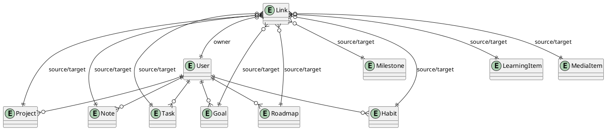
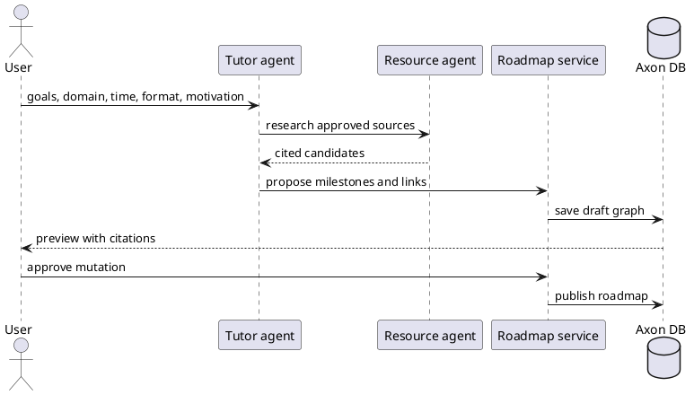
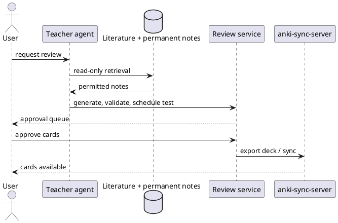
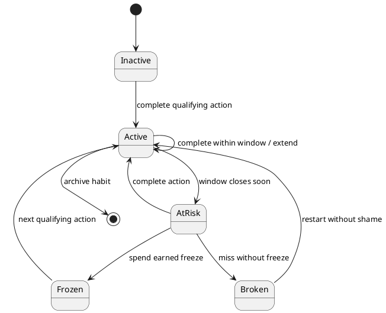
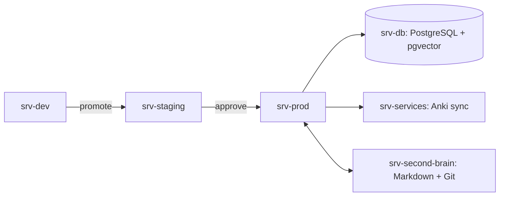
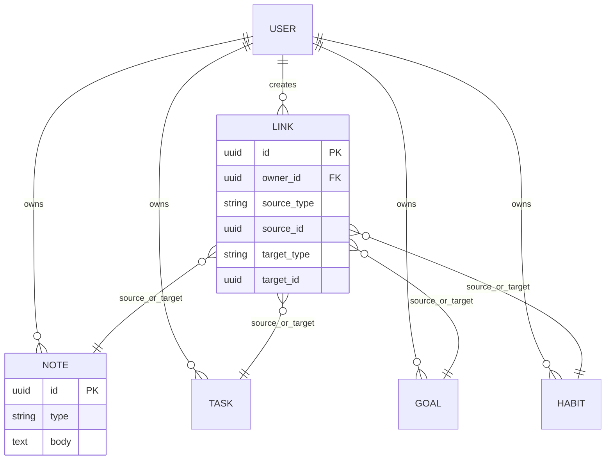

<p align="center">
  
  
  
</p>

<h1 align="center">Axon</h1>

<p align="center"><strong>Your self-hosted life, connected.</strong><br>Notes, action, learning, health, projects, and reflection in one humane graph.</p>

<p align="center"><strong>English</strong> · <a href="README.fr.md">Français</a></p>

> [!NOTE]
> Axon is in active development. Features marked ✅ work today; the others are planned, in the order given in the [roadmap](#roadmap). Axon is not a medical device, a therapist, or a promise of production readiness.

## Table of contents

- [Why Axon?](#why-axon)
- [Features](#features)
- [Architecture](#architecture)
- [Tech stack](#tech-stack)
- [Hardware](#hardware-requirements)
- [Quick start](#quick-start)
- [Configuration](#configuration)
- [Security and GDPR](#security-and-gdpr)
- [AI agents](#ai-agents)
- [Gamification](#gamification)
- [Development](#development-workflow)
- [Testing and operations](#testing-and-operations)
- [Roadmap](#roadmap)
- [Contributing](#contributing)
- [License and acknowledgements](#license-and-acknowledgements)

## Why Axon?

Axon brings together the things that are usually scattered across note apps, task lists, trackers, courses, and spreadsheets. Its center is not a feed or a streak counter: it is a user-owned graph of commitments, knowledge, and evidence. Self-hosting, exportability, explicit consent, and reversible automation are first-class requirements.

> [!WARNING]
> Do not enter medical emergencies, secrets, or another person’s personal data. Coach outputs are informational and require qualified professional judgment.

### Operational principles

1. **You own your data.** Everything exports in open formats; erasure is verified, not just queued.
2. **Private by default.** Consent is explicit, per purpose, and revocable.
3. **Agents propose, people decide.** No AI-generated change takes effect without approval.
4. **Works without AI.** Every feature is useful with agents and external APIs turned off.
5. **Reversible over clever.** Prefer explicit, reversible actions and boring technology.
6. **Recovery, not punishment.** A missed day leads back in, never to shame.
7. **Operable by others.** Anyone with the docs can run, observe, and restore it.

## Features

### 🧠 Second Brain and Zettelkasten
- ✅ A notes workspace: folder tree, live Markdown editor with preview, `[[wikilinks]]` with suggestions, backlinks and mentions, tags, callouts, tables, daily notes, templates, and a command center (Ctrl+K).
- ✅ PARA folders and Zettelkasten notes, Markdown import and export.
- ✅ Two-way sync with the `~/SecondBrain` vault (Git), keeping both versions on conflict.
- ✅ Vim keybindings in the note editor (optional), and keyboard shortcuts everywhere: press `?` for the list, `g` then a letter to jump to a page.
- Planned: live sync within seconds, a knowledge explorer with filters and charts, and an NLP knowledge graph.

### ✅ Action and execution
- ✅ Tasks with Today, week, and GTD views (inbox, next, waiting, someday), contexts, recurrence, one-key capture, and daily check-ins.
- ✅ Projects with Kanban boards (keyboard-accessible, WIP limits), epics, issues, sub-tasks, and project docs.
- ✅ Today dashboard with defined KPIs, a calendar, and iCal feeds.
- ✅ A command dashboard on Today: KPIs compared with the previous period, daily activity and 12-month charts, tables of what needs attention, and a network of your hard and soft skills linked to goals, projects, and notes.
- ✅ Pomodoro focus sessions (25/5 × 3 with a 15-minute long break by default, all adjustable, any number of sessions) linked to the task, project, skill, or note you work on, with focus time on the dashboard, a daily streak, focus sounds generated in the browser (noise, rain), and your own music links per activity.
- Planned: personal finance.

### 🌱 Habits, goals, and roadmaps
- ✅ Habits designed with James Clear's Atomic Habits: build good habits (obvious, attractive, easy, satisfying) or break bad ones (invisible, unattractive, difficult, unsatisfying), habit stacking ("After I…, I will…"), implementation intentions ("I will… at… in…"), an identity that every check-in votes for, habit contracts, the habits scorecard, two-minute versions, and gentle recovery prompts.
- ✅ Goals and milestones connected to tasks, notes, habits, projects, and roadmaps, with explained progress and a weekly review.
- ✅ Roadmaps you build by hand, import from OSSU, or start from Axon's curated library: 24 domains of the most recommended books, papers, university lectures, courses, and channels, from computer science and maths to Kubernetes, MLOps, and security. Each one is shown as a list or a layered skill graph.
- ✅ A skills assessment before you start: your situation, goals, and quick checks per domain give an explained level, and roadmaps start at your level.
- ✅ A Tutor agent that interviews you and drafts a roadmap where every skill cites its source, and a Resources agent that finds material for what you are learning. Both wait for your approval.
- ✅ Connect any element to any other, from wherever it is shown.

### 📚 Learning and media
- ✅ Illustrated flashcards you can view, add, edit, and remove, reviewed with FSRS-5 (the Anki scheduler, matched to its reference implementation), practice tests, and a Teacher agent that writes retrieval questions from your literature and permanent notes for your approval.
- ✅ Anki packages (.apkg) per deck, pictures included; planned: automatic sync to `anki-sync-server` on `srv-services` (EP-42).
- Planned: movie, TV, and book tracking backed by TMDB and Open Library.

### 🥗 Health and sport
- Planned: food logging through Open Food Facts and USDA FoodData Central.
- Planned: workouts plus Personal Trainer and Nutritionist agents with conservative, educational outputs.

### ✨ Humane progress
- Planned: XP, levels, badges, and streaks across every area, with freezes bought only with earned points.
- ✅ Ethical design: no dark patterns, no shame, no hidden consent, GDPR-aware controls.
- ✅ A profile picture, with a generated default (your initials on your own colours); uploads are re-encoded so no location data survives.
- ✅ Preferences in one place: English or French, theme, font, text size, icons, motion, templates for notes, projects, and resources, and your AI provider and budget. Edit them in the app or as a YAML file (keys are write-only).

## Screenshots

| Home | Today (light) | Today (dark, phone) |
|---|---|---|
|  |  |  |

| Command dashboard | Notes workspace | Command center |
|---|---|---|
|  |  |  |

Captured from a test account with sample data.

<details><summary>Design direction</summary>

Large typography, generous whitespace, dark mode, translucent glass over bundled scenery (ADR 0010). Motion should clarify state like a well-made instrument—not compete for attention. Respect reduced-motion preferences and keep every action usable without animation.

</details>

## Architecture

Axon uses a Go modular monolith first, PostgreSQL 16 + pgvector as the system of record, Redis/Valkey for ephemeral coordination, and SvelteKit + TypeScript for the web application. Agents call bounded tools through an approval-aware orchestration layer.

### PlantUML — C4 context

```plantuml
@startuml
!include https://raw.githubusercontent.com/plantuml-stdlib/C4-PlantUML/master/C4_Context.puml
LAYOUT_WITH_LEGEND()
Person(user, "User", "Owns data and approves mutations")
System(axon, "Axon", "Self-hosted life OS")
System_Ext(anthropic, "Anthropic API", "Claude / Agent SDK")
System_Ext(metadata, "Metadata APIs", "TMDB, Open Library, Open Food Facts")
Rel(user, axon, "Plans, captures, reviews")
Rel(axon, anthropic, "Sends approved prompts/tools")
Rel(axon, metadata, "Fetches attributed metadata")
@enduml
```

### PlantUML — container diagram

```plantuml
@startuml
!include https://raw.githubusercontent.com/plantuml-stdlib/C4-PlantUML/master/C4_Container.puml
Person(user, "User")
System_Boundary(axon, "Axon") {
  Container(web, "Web", "SvelteKit/TypeScript", "Accessible UI")
  Container(api, "API", "Go/chi", "REST/OpenAPI 3.1")
  Container(agents, "Agent runtime", "Go workers + Claude tools", "Bounded workflows")
  ContainerDb(db, "PostgreSQL", "Postgres 16 + pgvector", "System of record")
  Container(cache, "Redis/Valkey", "Cache/queues", "Ephemeral coordination")
}
Rel(user, web, "HTTPS")
Rel(web, api, "JSON/REST")
Rel(api, db, "SQL")
Rel(api, cache, "Jobs and cache")
Rel(agents, api, "Approved tools")
Rel(agents, db, "Read/write through policy")
@enduml
```

### PlantUML — deployment

```plantuml
@startuml
node "srv-dev" as dev { artifact "Axon dev" as d }
node "srv-staging" as stg { artifact "Axon staging" as s }
node "srv-prod" as prod { artifact "Axon production" as p }
node "srv-db" as db {
  database "PostgreSQL 16 + pgvector" as pg
  artifact "Redis/Valkey" as rv
}
node "srv-services" as svc { artifact "anki-sync-server" as anki }
node "srv-second-brain" as sb { artifact "~/SecondBrain Markdown" as notes }
dev ..> stg : GitOps promotion
stg ..> prod : approved promotion
prod --> db : private WireGuard/Tailscale
prod --> svc : Anki sync
prod <--> sb : Git + watcher
@enduml
```

### PlantUML — core entities and polymorphic graph



### PlantUML — Tutor agent roadmap generation



### PlantUML — Teacher agent and Anki export



### PlantUML — streak and freeze states



### Mermaid — deployment



### Mermaid — core ER and links



## Tech stack

| Layer | Choice | Why |
|---|---|---|
| Backend | Go + chi | Low memory, explicit concurrency, simple deployment, strong tooling. |
| API | REST + OpenAPI 3.1; optional GraphQL later | Cacheable, observable, generated clients; avoid premature flexibility. |
| Frontend | SvelteKit + TypeScript, design tokens + scoped CSS ([ADR 0007](doc/adr/0007-styling-without-tailwind.md)) | Small, fast UI with accessible progressive enhancement. |
| Data | PostgreSQL 16 + pgvector | Durable relational core, full text, vectors, constraints, extensions. |
| Jobs | Redis/Valkey + database-backed idempotency | Practical queues without hiding source of truth. |
| Graph view | D3 or Sigma.js | Scalable interactive skill and relationship visualization. |
| Auth | Built-in WebAuthn + TOTP | Passkeys, MFA, self-hosted control. |
| Edge | Caddy or Traefik | Automatic TLS and clear routing. |
| Ops | Prometheus, Grafana, Loki, OpenTelemetry | Metrics, dashboards, logs, traces. |
| Delivery | GitOps or Compose + Ansible/OpenTofu | Reproducible promotion suited to small clusters. |
| Security | SOPS/age, Trivy, SBOM, Renovate, SLSA practices | Reduce supply-chain and secret risk. |

Where the table offers a choice, [ADR 0002](doc/adr/0002-initial-technology-stack.md) proposes one: built-in WebAuthn + TOTP, Caddy, and Compose + Ansible.

**Why Go and not Rust?** Rust would give stronger compile-time guarantees and somewhat lower memory use. Axon's work, though, is I/O-bound (PostgreSQL, HTTP, AI providers), where Go is as fast in practice. Go also compiles in seconds, has first-party SDKs for the services Axon uses, and keeps the codebase easy for one maintainer and AI agents to read. Rewriting the existing API would stop feature work for months without a user-visible gain. The choice is recorded in ADR 0002, and the [change log](doc/BACKLOG.md#change-log) notes that a rewrite was considered and not scheduled.

## Hardware requirements

| Host | Baseline | Comfortable | Workload rationale |
|---|---:|---:|---|
| `srv-dev` | 2 vCPU / 4 GB / 60 GB SSD | 4 / 8 GB / 120 GB | Builds, local integration, preview deployments. |
| `srv-staging` | 2 vCPU / 4 GB / 80 GB SSD | 4 / 8 GB / 160 GB | Production-like verification and migrations. |
| `srv-prod` | 4 vCPU / 8 GB / 120 GB SSD | 8 / 16 GB / 300 GB | Web/API, workers, cache, agent queues. |
| `srv-db` | 4 vCPU / 8 GB / 200 GB SSD | 8 / 32 GB / 1 TB NVMe | PostgreSQL, pgvector, WAL, backups; prioritize IOPS. |
| `srv-services` | 1 vCPU / 1 GB / 20 GB | 2 / 2 GB / 50 GB | Existing Anki sync service. |
| `srv-second-brain` | 1 vCPU / 1 GB / 50 GB | 2 / 2 GB / 100 GB | Markdown, Git mirror, watcher. |

This table is the target layout. Until measurements justify splitting, Axon runs on `srv-prod` alone, with staging as a second Compose project, alongside the existing `srv-services` and `srv-second-brain` ([ADR 0003](doc/adr/0003-single-host-first.md)).

> [!NOTE]
> Low-memory targets assume bounded workers, connection pooling, pagination, and no local model inference. External-model calls are rate-limited and budgeted.

## Quick start

> [!IMPORTANT]
> Axon is early: passkey accounts, privacy controls, the graph API, a daily dashboard and calendar, Tasks, a notes workspace with vault sync, Goals, Projects with Kanban boards, learning roadmaps with a curated library, Habits, a demo account, and approval-gated AI agents on the provider of your choice work today. Further features arrive Epic by Epic.

### Prerequisites

- Docker Engine and Compose v2; Git; GNU Make for the checks.
- Only if you use agents: a key for Anthropic, OpenAI, Mistral, Google Gemini, or DeepSeek, or a local model server (Ollama, LM Studio, vLLM). Each person can choose their own in the app.
- Optional: TMDB, Open Library, USDA, and Open Food Facts credentials or public endpoints according to their terms.

```bash
git clone git@github.com:thoutmose/axon.git   # private repository
cd axon
cp .env.example .env
docker compose up -d --build --wait
docker compose exec api axon migrate up
```

Then open <http://localhost:3000>. The API is served under `/api` (for example `/api/healthz` and `/api/readyz`). The stack listens on `127.0.0.1` only. To try it with sample data, set `AXON_DEMO=1` in `.env`, restart, run `docker compose exec api axon demo reset`, and press **Try the demo**.

**API reference.** The OpenAPI 3.1 document is at `/api/v1/openapi.yaml` ([source](api/openapi/openapi.yaml)), and an interactive Swagger UI is at `/api-docs/index.html`, served by Axon itself.

### Checks

| Command | What it runs |
|---|---|
| `make check` | `gofmt`, golangci-lint, Go unit tests; `svelte-check`, Prettier, Vitest (Node 24 in a container); README language parity |
| `make test-integration` | API, OpenAPI contract, agent eval, and migration tests against PostgreSQL 16 + pgvector |
| `make up` / `make down` | Build and start, or stop, the local stack |

## Configuration

| Variable | Required | Example | Purpose |
|---|---|---|---|
| `AXON_BASE_URL` | Yes | `https://axon.example` | Canonical URL and callback origin. |
| `AXON_ENV` | Yes | `development` | Environment behavior and safeguards. |
| `DATABASE_URL` | Yes | `postgres://...` | PostgreSQL connection; store as a secret. |
| `REDIS_URL` | Yes | `redis://...` | Queue/cache connection. |
| `AXON_ENCRYPTION_KEY` | Prod | `openssl rand -hex 32` | Encrypts TOTP secrets at rest; never commit. |
| `AXON_REGISTRATION` | No | `first-user` | `first-user` lets only the first account register; `open` allows anyone who can reach Axon. |
| `AXON_DEMO` | No | `1` | Offer a shared demo account with sample data, reset every night. |
| `WEBAUTHN_RP_ID` | Prod | `axon.example` | Passkey relying-party ID. |
| `ANTHROPIC_API_KEY` | Optional | secret | Server default Anthropic key for agents (people can also set their own provider). |
| `AXON_ANTHROPIC_OAUTH` | Optional | config | `1` to use an `ant auth login` profile instead of a key. |
| `TMDB_API_KEY` | Optional | secret | Media metadata adapter. |
| `ANKI_SYNC_URL` | Optional | private URL | Host service integration. |
| `OTEL_EXPORTER_OTLP_ENDPOINT` | Optional | private URL | Trace export. |
| `S3_BACKUP_BUCKET` | Optional | bucket | Encrypted backup destination. |

Never put secrets in Markdown, issue text, prompts, screenshots, or logs. Use SOPS/age and a secret manager appropriate to the deployment.

## Security and GDPR

Axon follows OWASP ASVS as a verification baseline and CIS guidance for hosts. Network traffic between servers uses WireGuard or Tailscale; public ingress is limited to the reverse proxy. WebAuthn/passkeys and TOTP protect accounts; sessions rotate and revoke. RBAC and per-user ownership checks apply at every API boundary.

Privacy controls include consent records, purpose limitation, retention policies, export, erasure requests, audit trails, processor inventories, and redaction of prompts and logs. Backups are encrypted and have documented deletion windows. Health and learning data are sensitive; default visibility is private.

> [!NOTE]
> GDPR compliance is a continuing operational program, not a badge. Obtain appropriate legal advice for your deployment and jurisdiction.

## AI agents

| Agent | Responsibility | Guardrail | Status |
|---|---|---|---|
| Task Manager | Triage and schedule work. | Preview before changing due dates. | ✅ |
| Goals/Milestones | Break outcomes into measurable steps. | No silent commitments or dates. | ✅ |
| Habits | Suggest cues, stacks, recovery, and reviews. | No shame or manipulative pressure. | ✅ |
| Side-Projects | Analyze repos into epics, issues, and tasks. | Read-only; issues are proposals. | ✅ |
| Code Review | Review diffs, tests, security, and maintainability. | Can comment after approval; can never approve or merge. | ✅ |
| Tutor | Interview, research, and draft roadmaps. | Every skill cites a source from the library or an allowlisted site; user approves. | ✅ |
| Resource | Find and classify cited resources. | Allowlisted sites only, robots.txt honoured, 15 pages per run, links not copies. | ✅ |
| Teacher | Generate reviewed retrieval practice and flashcards. | Reads only literature/permanent notes. | ✅ |
| Media | Normalize metadata and recommend. | Explain sources; user controls profile. | Planned |
| Personal Trainer | Suggest training plans. | Conservative, non-medical, injury-aware. | Planned |
| Nutritionist | Help log food and patterns. | Educational; no diagnosis or unsafe restriction. | Planned |

All agents share a constitution: simple, explicit, small diffs, read before write, think in data, test everything, do not be clever. Skills are versioned `SKILL.md` files. Each task ends with reflection, lessons learned, evaluation evidence, and—when needed—human-in-the-loop approval.

## Gamification

Progress systems use XP, levels, streaks, badges, variable rewards, commitment devices, and earned-point streak freezes. The design is opt-in and transparent: users can disable competitive surfaces, see how points are calculated, and recover from missed days without humiliation. Inspiration includes *Hooked*, Octalysis, and Self-Determination Theory; the ethical constraint is stronger than engagement metrics.

## Development workflow

1. Pick the next ready issue in [BACKLOG.md](doc/BACKLOG.md); do not work across Epics.
2. Create a scoped branch and write tests or acceptance examples first.
3. Implement a small vertical slice; keep migrations reversible and APIs documented.
4. Run formatting, linting, unit/integration/contract/accessibility/security checks.
5. Open a Conventional Commit PR/MR with evidence, risk, rollback, and docs.
6. Request independent review, human approval, merge, deploy to staging, and observe before promotion.

## Testing and operations

- **Testing:** Go unit tests, PostgreSQL integration tests, OpenAPI contract tests, Playwright browser tests, accessibility checks, agent evals, migration rehearsal, and backup restore drills.
- **Observability:** Prometheus metrics, Grafana dashboards, Loki logs, OpenTelemetry traces, correlation IDs, queue depth, provider latency, token cost, and redacted agent decisions.
- **Reliability:** Define SLOs, alerts, RPO/RTO, rate limits, idempotency keys, circuit breakers, and runbooks before calling a feature done.
- **Supply chain:** Renovate, SBOMs, Trivy scans, pinned images, signed artifacts where practical, and SLSA-informed provenance.

## Roadmap

| Phase | Outcome | Backlog, in order |
|---|---|---|
| Foundation | Secure deployment, CI, observability, auth, privacy. | EP-00 → 01 → 02 → 03 → 04 |
| Personal graph | Links, tasks, notes, goals, dashboard — no AI required. | EP-05 → 06 → 07 → 09 → 11 → 13 → 08 |
| Guided growth | Agents, habits, projects, roadmaps, notes workspace, delivery and tutor agents. | EP-19 → 12 → 22 → 23 → 24 → 25 → 10 → 26 → 14 → 27 |
| Daily driver | Demo, bilingual docs, dashboard, settings, shortcuts, avatars, Atomic Habits, Pomodoro, learning and Anki, gamification, live vault, knowledge graph, themed spaces, finance, portability. | EP-28 → 29 → 30 → 41 → 31 → 32 → 33 → 34 → 35 → 16 → 42 → 15 → 36 → 37 → 38 → 39 → 40 |
| Whole-life beta | Media, health, nutrition, analytics. | EP-17 → 18 → 20 |
| 1.0 | Hardening, recovery, documentation, upgrade path. | EP-21 |

Current status: **EP-00–EP-14, EP-16, EP-19, EP-22–EP-35, and EP-41 done; EP-42 next.** To look around without an account, use **Try the demo** on the landing page: a shared account with sample data, reset every night. Operations: [doc/operations.md](doc/operations.md). Details in [doc/BACKLOG.md](doc/BACKLOG.md#delivery-order).

## Contributing

Contributions are welcome when they improve user agency, accessibility, privacy, or maintainability. Please read [CONTRIBUTING.md](CONTRIBUTING.md) and the [Code of Conduct](CODE_OF_CONDUCT.md), open an issue with context and acceptance criteria, and keep changes small. For security vulnerabilities, follow [SECURITY.md](SECURITY.md) rather than opening a public issue.

## License and acknowledgements

Axon is licensed under **AGPL-3.0-or-later** so hosted modifications remain available to the community. See [LICENSE](LICENSE) for the authoritative text.

Acknowledgements and reading: [roadmap.sh](https://roadmap.sh/), [OSSU](https://github.com/ossu/computer-science), [Anki sync server](https://github.com/ankicommunity/anki-sync-server), [TMDB API](https://developer.themoviedb.org/docs/getting-started), [Open Library API](https://openlibrary.org/developers/api), [Open Food Facts](https://world.openfoodfacts.org/data), [OWASP ASVS](https://owasp.org/www-project-application-security-verification-standard/), [Twelve-Factor App](https://12factor.net/), [Google SRE book](https://sre.google/sre-book/table-of-contents/), [FSRS](https://github.com/open-spaced-repetition/free-spaced-repetition-scheduler), and [Anthropic documentation](https://docs.anthropic.com/en/docs).

Books that shape the product: *Understanding How We Learn* (Weinstein, Sumeracki, Caviglioli), *Moonwalking with Einstein* (Foer), *Make It Stick*, *Atomic Habits* (Clear), *Hooked* (Eyal), *The Octalysis Framework* (Chou), *Building a Second Brain* (Forte), *How to Take Smart Notes* (Ahrens), and *Designing Data-Intensive Applications* (Kleppmann).

---

<p align="center"><sub>Axon — build a life you can understand, one small link at a time.</sub></p>
