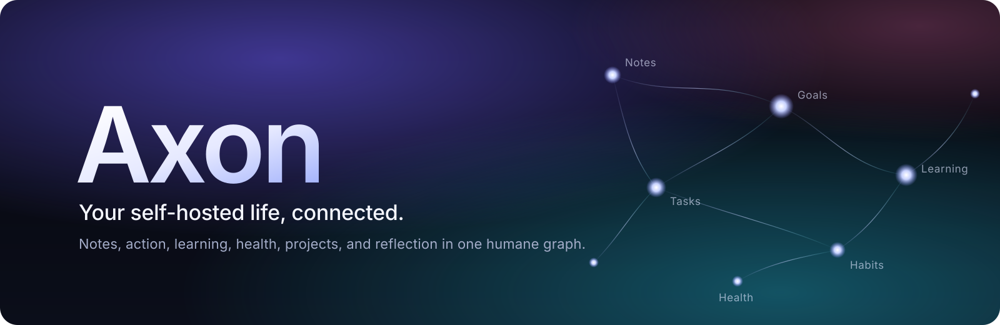

<p align="center"></p>

<p align="center">
  
  
  
  
</p>

<p align="center"><strong>English</strong> · <a href="README.fr.md">Français</a></p>

<p align="center"><b>Notes, tasks, habits, learning, health, and projects in one graph you own.</b><br>
Self-hosted, private by default, useful without AI, and every AI change waits for your approval.</p>

[](web/static/teaser/axon-trailer-4k.mp4)

<p align="center"><a href="web/static/teaser/axon-trailer-4k.mp4">Watch the trailer</a> · <a href="https://axon.thoutmose.me">Try the demo</a></p>

## What it does

| Area | Highlights |
|---|---|
| **Second brain** | Markdown notes with wikilinks, backlinks, maths, drawings, and pictures; a knowledge graph built on your server; two-way sync with an Obsidian-style vault. |
| **Action** | Tasks with GTD views and quick add, Kanban projects, calendars in and out, reminders, a weekly review, and focus sessions with music. |
| **Growth** | Atomic Habits, goals and milestones, a 47-domain engineering roadmap with its certifications, a skills radar, and a decision journal. |
| **Learning** | FSRS flashcards with Anki sync, free recall, memory palaces, a practice log, and a tech watch with its news graph and podcast. |
| **Life** | Films, series, books, and games; budget and savings; water, caffeine, food, training, and a daily journal, each under its own consent. |
| **Agents** | Thirteen agents and Jarvis on the provider you choose, a local model included; they propose, you decide. |

The full list, with screenshots, is in **[doc/features.md](doc/features.md)**.

## Principles

1. **You own your data.** Everything exports in open formats; erasure is verified.
2. **Private by default.** Consent is explicit, per purpose, and revocable.
3. **Agents propose, people decide.** No AI change takes effect without approval.
4. **Works without AI.** Every feature is useful with agents and external APIs turned off.
5. **Recovery, not punishment.** A missed day leads back in, never to shame.

## Quick start

You need Docker Engine with Compose v2.

```bash
git clone https://github.com/thoutmose/axon.git
cd axon
cp .env.example .env
docker compose up -d --build --wait
docker compose exec api axon migrate up
```

Open <http://localhost:3000> and create the first account. To look around with sample data, set `AXON_DEMO=1` in `.env`, restart, run `docker compose exec api axon demo reset`, and press **Try the demo**.

For a real server, follow the **[install guide](doc/install.md)**, then **[your first afternoon](doc/getting-started.md)**.

## Documentation

| Guide | What it covers |
|---|---|
| [Install](doc/install.md) · [Upgrade](doc/upgrading.md) | Running Axon on your own host, HTTPS, backups, and moving between versions. |
| [User guide](doc/user-guide.md) | Every page, how to use it, and what it keeps. |
| [Architecture](doc/architecture.md) | Diagrams, the stack, hardware, configuration, and security. |
| [Operations](doc/operations.md) · [Runbooks](doc/runbooks.md) | Deploying, monitoring, restoring, and incidents. |
| [Privacy](doc/privacy.md) · [Security](SECURITY.md) | What is collected, where it goes, and how to report a vulnerability. |
| [Decisions](doc/adr/) · [Changelog](CHANGELOG.md) | Why Axon is built the way it is, and what changed. |

The API is described by OpenAPI 3.1 at `/api/v1/openapi.yaml` ([source](api/openapi/openapi.yaml)), with a Swagger UI at `/api-docs/`.

## Built with

Go and chi, SvelteKit and TypeScript, PostgreSQL 16 with pgvector, and Caddy, on one host with Docker Compose. Two vCPU and 4 GB of memory are enough; the API serves 700 requests a second on a small server.

## Contributing

Contributions that improve user agency, accessibility, privacy, or maintainability are welcome. Read [CONTRIBUTING.md](CONTRIBUTING.md) and the [Code of Conduct](CODE_OF_CONDUCT.md), and run `make check` before you open a pull request. Report vulnerabilities privately as described in [SECURITY.md](SECURITY.md).

## License

[AGPL-3.0-or-later](LICENSE). Catalogue data comes from Open Library, TMDB, Open Food Facts, USDA FoodData Central, and Open English WordNet under their own terms; this product uses the TMDB API but is not endorsed or certified by TMDB.

> [!NOTE]
> Axon is not a medical device or a therapist. Health and coaching outputs are informational.

---

<p align="center"><sub>Axon — build a life you can understand, one small link at a time.</sub></p>
