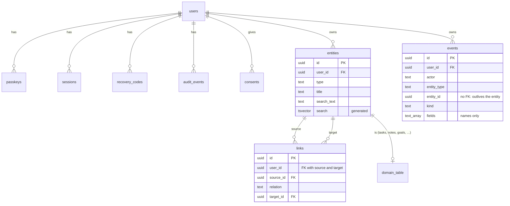

# Data model

Conventions: [ADR 0005](adr/0005-entity-conventions.md). Entities and links: [ADR 0006](adr/0006-entity-registry-and-links.md). Classification and retention: [privacy.md](privacy.md).

## Rules for a new entity type

1. Create the domain table with `id uuid PRIMARY KEY REFERENCES entities(id) ON DELETE CASCADE`; no `user_id` column is needed (ownership lives on `entities`).
2. Register it with `graph.RegisterType` (name, table, export function) and any typed relations with `graph.RegisterRelation`.
3. Create rows with `graph.CreateEntity` and the domain insert in one transaction; update with `graph.UpdateEntity`, listing changed field names; delete with `graph.DeleteEntity`.
4. Put searchable text in `title` and `search_text`.

`TestEveryEntityTableIsRegistered` fails if step 2 is missed, and `axon integrity` (run on every deployment) fails if step 3 is.
