# Fonctionnalités

Toutes les fonctionnalités d’Axon, domaine par domaine. Retour au [README](../README.fr.md) · [English](features.md).

## Fonctionnalités

### 🧠 Second cerveau et Zettelkasten
- ✅ Un espace de notes : arborescence de dossiers, éditeur Markdown avec aperçu en direct, `[[liens wiki]]` avec suggestions, rétroliens et mentions, étiquettes, encadrés, tableaux, notes quotidiennes, modèles et centre de commandes (Ctrl+K).
- ✅ Dossiers PARA et notes Zettelkasten, import et export Markdown.
- ✅ Synchronisation bidirectionnelle avec le coffre `~/SecondBrain` (Git), qui garde les deux versions en cas de conflit.
- ✅ Raccourcis Vim dans l’éditeur de notes (en option), et raccourcis clavier partout : `?` pour la liste, `g` puis une lettre pour aller à une page.
- ✅ Synchronisation en direct avec votre coffre Markdown : ajoutez, modifiez, renommez ou supprimez un fichier et la note suit en quelques secondes, et inversement ; les modèles du coffre apparaissent dans Axon.
- ✅ Vos notes vivent dans Axon par défaut ; indiquez un serveur et un dossier dans les Préférences et une seule commande l’appaire, le synchronise dans les deux sens et prépare un coffre vide avec ses dossiers et ses modèles (Axon indique s’il est à jour).
- ✅ Dessiner dans les notes : une feuille avec stylo, surligneur, flèches, cadres et texte enregistre un SVG que la note intègre, visible dans Axon comme dans le coffre, et rouvert pour continuer à dessiner. Le haut des Notes dit où vivent vos notes : dans Axon seulement, ou aussi dans un coffre tenu à jour dans les deux sens.
- ✅ Des récapitulatifs du jour, de la semaine et du mois par e-mail, Slack, Discord, Microsoft Teams, Telegram, ntfy ou un webhook : ce qu’il y a à faire, ce qui arrive (tâches, jalons, objectifs), ce qu’il faut apprendre et se remémorer, le bilan de la semaine ou du mois, avec une image dessinée pour le jour et une citation choisie pour lui.
- ✅ Un récapitulatif de l’actualité : les sources marquées comme actualité générale (un import FreshRSS, par exemple) restent à part de la veille technologique, et les principales histoires du jour sont classées selon le nombre de médias qui les relaient.
- ✅ Répondez au récapitulatif dans Slack, Discord ou Telegram : « fait 2 », « j’ai terminé le passeport », « ajoute appeler la banque demain à 15h », « reporte 3 lundi », « note … », « annule » — Axon le fait aussitôt, en français ou en anglais, sans adresse publique.
- ✅ Connexion avec Google, Microsoft, Apple, Discord, Slack ou votre propre fournisseur OpenID Connect, liés par vous dans Compte → Connexion et sécurité (jamais par l’adresse e-mail) ; les clés d’accès restent le moyen le plus sûr.
- ✅ Une veille technologique : suivez des flux, des sites, des auteurs Medium, des Substack, des chaînes YouTube et des dépôts GitHub (à la main, en CSV, en OPML ou depuis FreshRSS) selon une planification, minuit par défaut ; chaque histoire est gardée une seule fois quel que soit le nombre de sources, étiquetée par du TAL local, lue comme une note de veille et gardée en note quand elle compte ; chaque source affiche sa santé. Un graphe des actualités montre leurs concepts, leurs liens et ce qui monte, à part du graphe des notes, avec un résumé au survol. Toute vue s’exporte en PDF, ODS, CSV, Markdown, notes de veille ou JSON, ou devient un lien en lecture seule à partager. Activez son podcast pour écouter les meilleures actualités lues par votre appareil, et retrouvez-les dans vos récapitulatifs, dont vous choisissez les rubriques. Un agent de veille propose des sources et des sujets que vous approuvez.
- ✅ Un explorateur de connaissances (Notes → Explorer) : filtres par PARA, type Zettelkasten, étiquette, texte, date ou notes non reliées ; graphiques des notes dans le temps, par PARA et par type, des étiquettes et des mots-clés partagés ; et un graphe de connaissances qui ajoute à vos liens des relations NLP locales (entités partagées, mots-clés distinctifs, synonymes anglais et français, formulations proches), chacune expliquant pourquoi elle existe. Aucun fournisseur d’IA n’est utilisé.
- ✅ Analyse des notes de lecture et permanentes (Notes → Analyse) : racinisation Snowball en anglais et en français, expressions clés par TextRank, lisibilité, thèmes issus de formulations proches, un graphe de concepts dont chaque lien s’explique (ensemble plus souvent que le hasard selon la NPMI, ou synonymes d’Open English WordNet), et sur chaque note ses expressions clés, son thème et des idées liées avec leurs raisons. Tout reste local.
- ✅ Tout est une note dans votre coffre : tâches, objectifs, jalons, projets, domaines, ressources, archives, habitudes, films, séries et livres sont des notes Markdown sous `Axon/` (champs dans l’en-tête, texte en sections, une section Notes libre), synchronisées dans les deux sens : modifiez la note ou l’élément, l’autre suit ; une nouvelle note avec un type crée l’élément ; supprimer le fichier le supprime ; le déplacer dans `Archive/` l’archive. Les journaux d’alimentation et d’entraînement aussi, dans un seul sens, si vous l’activez.
- ✅ Des images et des PDF dans les notes : collez, déposez ou choisissez un fichier dans l’éditeur et il est intégré (``) ; les intégrations Obsidian comme `![[photo.png|300]]` s’affichent aussi. Les photos perdent leurs métadonnées et sont réduites à 2400 px ; les fichiers se synchronisent avec le coffre dans les deux sens et font partie de l’export.
- ✅ Des modèles pour chaque type de note, avec leurs sections affichées avant la création : éphémère, de lecture, permanente ; notes de projet, de domaine, de ressource et d’archive ; tâches, objectifs, jalons, projets, domaines, ressources, habitudes, films, séries, livres ; notes quotidiennes et de réunion ; et les modèles de votre coffre dans `Templates/` (Notes → Modèles).
- ✅ Un graphe de connaissances Zettelkasten sur la page Notes : notes de lecture et permanentes reliées par des indices combinés (expressions clés pondérées par l’IDF, synonymes WordNet, noms partagés, formulations proches, vos propres liens), communautés trouvées par la modularité de Louvain et nommées par TF-IDF de classe, centralité par PageRank, et notes passerelles entre communautés ; sélectionnez une note pour voir pourquoi elle est reliée.

### ✅ Action et exécution
- ✅ Des tâches avec les vues Aujourd’hui, semaine et GTD (boîte de réception, prochaines actions, en attente, un jour peut-être), contextes, récurrence, capture en une touche et bilans quotidiens.
- ✅ Des projets avec tableaux Kanban (utilisables au clavier, limites de travail en cours), epics, tickets, sous-tâches et documentation de projet ; les tâches s’ouvrent sur un tableau GTD, avec un Kanban à un clic ; le calendrier s’ouvre sur une grille mensuelle.
- ✅ Pages Domaines, Ressources et Archives (PARA), et des modèles pour chaque type de note, projet, domaine, ressource, objectif, jalon et habitude, conservés comme fichiers dans votre coffre.
- ✅ Un tableau de bord Aujourd’hui avec des indicateurs définis, un calendrier et des flux iCal.
- ✅ Un tableau de bord sur Aujourd’hui : indicateurs comparés à la période précédente, graphiques d’activité quotidienne et sur 12 mois, tableaux de ce qui demande votre attention, et un réseau de vos compétences techniques et humaines avec leurs prérequis (uniquement des compétences ; livres et cours restent rattachés à chacune).
- ✅ Sessions Pomodoro (25/5 × 4 puis 15 minutes de pause longue par défaut, tout est réglable, autant de sessions que voulu) liées à la tâche, au projet, à la compétence ou à la note travaillée, avec le temps de concentration sur le tableau de bord, une série quotidienne, des sons de concentration générés dans le navigateur (bruit, pluie), une musique composée pendant que vous travaillez et assortie à ce que vous faites (lo-fi pour les tâches et projets, ambiance pour les notes, piano calme pour les compétences et les cartes ; rien n’est diffusé depuis Internet) et vos propres liens de musique par activité.
- ✅ Finances personnelles dans l’esprit de Firefly III : comptes d’actifs et de passifs avec soldes, revenus, dépenses et virements (jamais comptés comme dépenses), catégories avec budgets mensuels, étiquettes, opérations récurrentes, règles de catégorisation, import CSV des relevés bancaires sans doublons, des rapports (flux mensuels, dépenses par catégorie, taux d’épargne, patrimoine net) et des tirelires pour un achat futur, avec un objectif, une date facultative et le montant à mettre de côté chaque mois ; la page Budget compte le solde de chaque compte, le patrimoine net, et les factures et revenus encore à venir ce mois-ci. Les montants sont des centimes entiers exacts ; les données financières restent hors de la recherche et des agents, et figurent dans votre export.

### 🌱 Habitudes, objectifs et parcours
- ✅ Des habitudes conçues avec *Atomic Habits* de James Clear : créer de bonnes habitudes (évidentes, attrayantes, faciles, satisfaisantes) ou en perdre de mauvaises (invisibles, repoussantes, difficiles, insatisfaisantes), enchaînement (« Après…, je… »), intentions de mise en œuvre (« Je… à… à/dans… »), une identité pour laquelle chaque bilan vote, contrats d’habitude, tableau des habitudes, versions de deux minutes et invitations bienveillantes à reprendre.
- ✅ Objectifs et jalons reliés aux tâches, notes, habitudes, projets et parcours, avec une progression expliquée et une revue hebdomadaire.
- ✅ Des parcours d’apprentissage créés à la main, ou le parcours livré avec Axon : le top 5 % dans 47 domaines de l’ingénierie, 18 phases du lundi 19 octobre 2026 à janvier 2031 avec leurs cours et livres, des certifications pour chaque domaine (141 en tout, classées par domaine et par éditeur) avec le travail de projet qui les prouve, et le bilan de compétences repassé à la fin de chaque phase. Le démarrer crée tout le plan, avec son rythme hebdomadaire en blocs d’étude dans l’agenda : l’objectif, un jalon et un projet par phase avec son examen de sortie en tâches et sous-tâches, les projets 42, quatre habitudes, les tâches de la première semaine, des domaines et des ressources. Chaque parcours s’affiche en liste ou en graphe de compétences par niveaux. Un domaine se prouve, il ne se coche pas : sa fiche d’évaluation, comme à l’École 42, avec les éléments de la preuve, leurs justificatifs, l’explication avec vos mots, une note de 0 à 125 et des nouveaux essais ; le plan dit de combien de jours il est en retard.
- ✅ Votre parcours aujourd’hui : la page Aujourd’hui montre la phase du plan et sa semaine, les jours avant son jalon, le créneau d’étude du jour, le projet de la phase et la prochaine certification, avec la concentration, la révision et la pratique à un clic. La bibliothèque montre les 18 jalons du plan avant de le démarrer.
- ✅ Une toile d’araignée des compétences : les savoir-faire techniques et comportementaux acquis, et ceux en cours, domaine par domaine.
- ✅ Une évaluation des compétences avant de commencer : votre situation, vos objectifs et quelques questions par domaine donnent un niveau expliqué, et les parcours démarrent à votre niveau.
- ✅ Un agent Tuteur qui vous interroge puis rédige un parcours dont chaque compétence cite sa source, et un agent Ressources qui trouve de quoi apprendre. Les deux attendent votre approbation.
- ✅ Reliez n’importe quel élément à n’importe quel autre, là où il s’affiche.

### 📚 Apprentissage et médias
- ✅ Un journal de pratique pour les problèmes, niveaux de wargames et labs (LeetCode, Codeforces, Advent of Code, OverTheWire, PortSwigger, Kaggle…) : collez un lien, notez chaque tentative résolue seul, avec aide ou non, et refaites-les à intervalles croissants ; résolus par difficulté, sujet et semaine.
- ✅ Un journal de décisions : notez un choix, ce que vous attendez et avec quelle probabilité ; faites-en le bilan le jour venu et voyez si vos prévisions sont bien calibrées (score de Brier, courbe de fiabilité).
- ✅ Café et thé : la caféine face à la limite quotidienne de l'EFSA, ce qu'il en reste au coucher, et le dernier café qui préserve votre sommeil, selon votre heure de coucher et votre métabolisme.
- ✅ Les protocoles santé d'Andrew Huberman dans Habitudes, chacun avec ses études, une note honnête des preuves, et une habitude en un clic.
- ✅ Une collection dans Progression : un trophée par compétence de la feuille de route, une carte par habitude, et des jalons, du bronze à l'argent puis à l'or.
- ✅ Invitations : le propriétaire fait entrer quelqu'un avec un lien à usage unique, même inscriptions fermées, et dans son foyer.
- ✅ Partager en image : votre niveau, une carte, un objectif ou une série d'habitude, dessinés sur votre appareil pour le menu de partage ou un post sur X, LinkedIn ou Bluesky.
- ✅ YouTube dans la veille : les mots d'une vidéo tirés de ses sous-titres, ou de votre serveur Whisper, dans son analyse et le graphe, en anglais, français ou espagnol, avec des liens sans pistage.
- ✅ Les podcasts de votre Audiobookshelf dans la veille, chaque épisode avec ses notes et, avec Whisper, ses paroles.
- ✅ Les certifications : prévues, réservées, obtenues ou échouées, avec le compte à rebours de l’examen, le coût face au plan, le certificat et l’expiration avec un rappel de renouvellement ; examens et expirations dans l’agenda. Le parcours prévoit ses 45 certifications.
- ✅ Les heures d’étude face au plan : le temps de concentration sur un parcours, cette semaine jour par jour à côté du bloc prévu et sur 12 semaines face à l’objectif hebdomadaire, par compétence et par projet.
- ✅ Des cartes mémoire illustrées à consulter, ajouter, modifier et supprimer, révisées avec FSRS-5 (le planificateur d’Anki, vérifié sur son implémentation de référence), des tests d’entraînement, et un agent Enseignant qui rédige des questions de récupération à partir de vos notes de lecture et permanentes, soumises à votre approbation.
- ✅ Un moteur d’apprentissage et de mémorisation inspiré de *Understanding How We Learn* et de *Moonwalking with Einstein* : Apprendre → Aujourd’hui planifie la journée (cartes à réviser et leur durée, notes à se remémorer, test mixte hebdomadaire, notes éphémères à traiter, cartes difficiles à travailler) ; quelques nouvelles cartes par jour et des paquets mélangés (entrelacement) ; écrire sa réponse avant de la voir ; chaque carte peut porter le pourquoi, un exemple concret, une image mentale frappante, et une image ou un dessin de l’IA (double codage) ; rappel libre de notes entières sur une page blanche, comparé à leurs idées clés et espacé davantage à chaque réussite ; palais de mémoire parcourus lieu par lieu ; cartes tirées de ce qu’une note marque (`question :: réponse`, `==terme==`, `**Terme** : définition`) ; et l’Enseignant rédige des cartes illustrées soumises à votre approbation.
- ✅ Votre mémoire, mesurée : Apprendre compare le rappel prévu par la planification avec ce dont vous vous êtes souvenu, face à votre rétention cible, et dit quoi changer.
- ✅ Couvertures des films, séries, livres et jeux, retrouvées aussi pour ce qui est ajouté à la main ou importé, sur une étagère d’affiches.
- ✅ Rappels de tâches à une heure précise : dans la tâche, ou tapez « Appeler la banque vendredi à 15h » dans la saisie rapide.
- ✅ Partager vers Axon : depuis la feuille de partage de toute application une fois installé, ou un favori sur ordinateur ; enregistrer comme note ou tâche, ou garder le texte lisible de la page comme note de lecture.
- ✅ Une corbeille : ce que vous supprimez reste 30 jours avec ce qui l’accompagnait (les jalons d’un objectif, les pointages d’une habitude), Annuler juste après la suppression, et Compte → Corbeille pour restaurer.
- ✅ Actions groupées sur les tâches (statut, contexte, échéance, suppression), et glisser les tâches d’un jour à l’autre de l’agenda ou dessus depuis les prochaines actions sans date.
- ✅ Un Aujourd’hui à votre façon : choisissez et ordonnez ses cartes, dont l’apprentissage, les habitudes, l’agenda du jour et le foyer.
- ✅ Seulement ce qui vous sert : un nouveau compte dit pour quoi il veut Axon, et le menu et Aujourd’hui n’affichent que ces pages ; chaque page se masque ou revient dans les Préférences.
- ✅ Recherche par le sens, si vous le voulez : choisissez un service de plongements (un serveur de modèles local, OpenAI ou Voyage AI) et donnez son consentement propre ; les notes se retrouvent alors par ce qu’elles veulent dire, dans le centre de commandes et sous « Proche par le sens ». Désactivée, les notes liées utilisent des statistiques de mots locales.
- ✅ Partage en foyer : les personnes d’un même Axon rejoignent le foyer avec un code à usage unique et partagent des listes (courses, tâches ménagères, tout), avec des éléments confiés à quelqu’un ; rien de personnel n’est partagé.
- ✅ Imports depuis d’autres applications : tâches Todoist et TickTick, livres Goodreads, films Letterboxd, transactions Firefly III et relevés bancaires OFX/QFX, pages Notion ; aperçu d’abord, et réimporter n’ajoute rien en double.
- ✅ Une revue hebdomadaire guidée façon Getting Things Done : vider sa tête, boîte de réception à zéro, notes éphémères, faits marquants de la semaine, deux semaines à venir, en attente, projets bloqués, objectifs, habitudes et apprentissage, un jour peut-être, et ce qui compte la semaine prochaine ; proposée le week-end au réveil tant qu’elle n’est pas faite.
- ✅ Vos autres agendas dans Axon, en lecture seule : suivez Google, Nextcloud ou tout serveur CalDAV, Outlook ou toute adresse ICS ; événements répétés, fuseaux horaires et exceptions gérés ; affichés dans les vues mois et agenda avec leur couleur.
- ✅ Saisie rapide de tout : appuyez sur n et tapez `Appeler le plombier @téléphone demain`, `livre: Atomic Habits`, `habitude: Lire une page`, `objectif: Courir 10 km d’ici 2027-05-01` ou `carte: question :: réponse #Paquet` ; la saisie montre ce qu’elle va ajouter.
- ✅ Rappels : un résumé le matin (tâches, cartes à réviser et leur durée, notes à se remémorer, habitudes, test hebdomadaire) et un rappel le soir (habitudes encore ouvertes, avec leur version de deux minutes), en notifications sur vos appareils, chiffrées de bout en bout, et par e-mail si votre serveur peut l’envoyer ; une fois par jour, seulement s’il y a quelque chose à dire, désactivés par défaut.
- ✅ Installable sur téléphone et ordinateur ; hors ligne, la saisie rapide garde tâches et notes sur l’appareil et les envoie, une seule fois, au retour de la connexion.
- ✅ Un menu en cinq groupes (Faire, Penser, Grandir, Vie, Bilan) plus Aujourd’hui, et une seule feuille Menu sur téléphone.
- ✅ Les agents là où vous travaillez : chaque page propose les agents dont les compétences lui correspondent (Gestionnaire de tâches sur Tâches et Aujourd’hui, Objectifs, Habitudes, l’Enseignant sur Notes, une note, Apprendre et Cartes, le Tuteur et Ressources sur Parcours, Médias, le Coach sportif et la Nutritionniste sur Santé, Projets annexes et Revue de code sur Projets, Veille sur la veille technologique), avec des demandes toutes prêtes et ce que la page affiche joint à la demande ; les propositions s’approuvent sur place.
- ✅ Jarvis, l’agent maître : un bouton ⚡ facultatif ouvre un panneau latéral où vous dites ce que vous voulez avec vos mots, et Jarvis demande aux bons agents (« Je lis Seul sur Mars » devient le livre, en cours de lecture, avec sa note, en attente de votre approbation), sur votre fournisseur ou un modèle Ollama local.
- ✅ Un modèle pour tous les agents, ou un pour chacun, et les jetons d’IA que chacun a utilisés, ce mois-ci et par mois, avec l’économie mesurée de la compaction de ce que les outils envoient au modèle.
- ✅ Paquets Anki (.apkg) par paquet de cartes, images comprises, et synchronisation automatique avec votre propre `anki-sync-server` (par exemple sur `srv-services`), à la demande ou dès que vous approuvez les cartes de l’Enseignant ; les cartes présentes seulement dans Anki ne sont jamais supprimées.
- ✅ Films, séries, livres et jeux vidéo : à voir, à lire ou à jouer, en cours, terminés ou abandonnés, avec une note sur 10, la progression en pages, épisodes, minutes ou heures de jeu, et une critique. Une fois les recherches autorisées (elles envoient le titre saisi), les livres viennent d’Open Library, les jeux de Wikipédia (avec leur couverture, leur année, leur genre et leur studio), et les films et séries de TMDB si le serveur a une clé ; tout peut s’ajouter à la main. Les couvertures sont copiées dans Axon, donc les pages ne chargent jamais d’images ailleurs. « À suivre » classe votre liste avec ses raisons (même créateur ou genre que ce que vous avez noté 8 ou plus, ou ce que vous avez commencé), et un agent Médias propose de nouveaux titres soumis à votre approbation.

### 🥗 Santé et sport
- ✅ L’eau : un verre ou une bouteille en un geste, face à la part des boissons dans votre besoin quotidien en eau, avec la semaine ; des données de santé, sous leur consentement.
- ✅ Un journal quotidien : humeur, énergie et stress sur cinq visages, heures de sommeil, trois choses pour lesquelles vous êtes reconnaissant et une note, avec les 30 derniers jours en graphique ; sur Aujourd’hui en deux gestes si vous voulez. Des données de santé, sous leur consentement.
- ✅ Ce qui vous aide : quelles habitudes vont avec vos meilleurs jours (sommeil, sport, concentration, habitudes, tâches, gratitude face à l’humeur, l’énergie et le stress), avec des statistiques qui écartent le hasard, présentées comme des liens, jamais comme des causes. Calculé sur votre serveur, sans IA.
- ✅ Journaux d’alimentation et d’entraînement, seulement après votre consentement à conserver des données de santé (le retirer les supprime) : repas avec énergie et macronutriments, trouvés dans Open Food Facts (par nom ou code-barres) ou USDA FoodData Central une fois les recherches autorisées, ou saisis ; séances avec séries, minutes et effort. Jamais dans la recherche ni les agents IA. La photo d’un repas estimée par votre propre fournisseur d’IA en aliments, portions et macronutriments que vous vérifiez avant de les noter (la photo n’est pas conservée ; ses informations d’appareil et de lieu sont retirées avant), et la photo d’un code-barres lue sur votre appareil. Des besoins quotidiens (énergie, protéines, glucides, lipides, fibres, eau) calculés selon votre âge, sexe, gabarit, activité et objectif à partir de références publiées, chacun expliqué, avec un avertissement à vérifier auprès d’un diététicien ; un objectif ne les déplace que dans des bornes (perdre doucement : 15 % en dessous, jamais sous 1 200 kcal, et aucune perte quand le maintien demande déjà 1 200 kcal ou moins ; prendre : 10 % au-dessus), les barres du jour et le Chef les suivant ; aucun avant 18 ans ni pendant la grossesse.
- ✅ Agents Coach sportif et Nutritionniste qui ne lisent vos journaux qu’avec un consentement distinct pour les partager avec votre fournisseur d’IA, proposent des séances ou des tâches de repas simples à approuver, renvoient les sujets d’alerte (douleur thoracique, malaise, troubles alimentaires, grossesse, médicaments…) vers un professionnel sans appeler le modèle, et ne peuvent jamais suggérer moins de 1 200 kcal par jour ni des jeûnes de plusieurs jours.

### ✨ Progrès à taille humaine
- ✅ Récompenses de progression optionnelles : des points pour chaque domaine (tâches, projets, habitudes, concentration, cartes mémoire, notes, parcours, objectifs), chacun traçable dans un registre, des niveaux, des badges, une série quotidienne avec des gels achetés uniquement avec des points gagnés, sans honte ni notifications.
- ✅ Analyses : neuf indicateurs hebdomadaires (tâches terminées et capturées, bilans d’habitudes, jalons, minutes de concentration, notes, cartes révisées, taux de rappel, compétences acquises), chacun avec sa formule, sa source, une tendance en mots simples et les éléments derrière chaque chiffre ; une revue hebdomadaire comparée à la semaine précédente, avec ce qui a changé et les tâches ouvertes à reporter ; export CSV. Tout est calculé sur votre serveur.
- ✅ Conception éthique : pas de dark patterns, pas de honte, pas de consentement caché, des contrôles conformes au RGPD.
- ✅ Une photo de profil, avec une image par défaut générée (vos initiales sur vos couleurs) ; les envois sont réencodés, aucune donnée de localisation ne subsiste.
- ✅ Des espaces thématiques : chaque domaine a son propre décor original, en clair et en sombre : un carnet de Léonard de Vinci pour les notes, une bibliothèque d’Oxford pour l’apprentissage, les ressources et les cartes mémoire, un plan d’atelier pour les projets, un jardin pour les habitudes, une carte topographique pour les objectifs et la progression, une carte du ciel pour le calendrier, un registre pour le budget, un vieil atlas pour les domaines et les archives, et du papier pointillé pour les tâches et la concentration. Les effets sont lents, s’arrêtent avec la réduction des animations et peuvent être désactivés dans les préférences. Journal, Tendances, la revue hebdomadaire et Agents ont aussi le leur (la lumière du soir de Vermeer, un observatoire, un phare, des automates) ; chaque page dit ce que montre son image et ce qu’elle évoque, et chaque type de note a son petit dessin.
- ✅ Un ciel qui suit le soleil : la page d’accueil et Aujourd’hui montrent le ciel tel qu’il est dans votre fuseau horaire, le soleil et la lune (avec sa phase) là où ils sont, les étoiles après le crépuscule, au-dessus du paysage de votre choix : montagnes, forêt, océan, désert, la Terre vue de l’orbite, ou un monument de chaque continent (tour Eiffel, pyramides de Gizeh, Taj Mahal, statue de la Liberté, Christ Rédempteur, opéra de Sydney). Le thème peut le suivre aussi : clair de l’aube au crépuscule.
- ✅ Déplacez tout votre Axon vers un autre serveur : `axon instance export` et `axon instance import` transportent chaque table et chaque image avec un manifeste de sommes de contrôle, vers une installation neuve, y compris depuis une version plus ancienne.
- ✅ Des préférences au même endroit : anglais ou français (toutes les pages, avec les dates dans votre langue), thème, police, taille du texte, icônes, animations, modèles pour les notes, projets et ressources, et votre fournisseur d’IA et budget. Modifiables dans l’application ou dans un fichier YAML (les clés sont en écriture seule).

## Agents IA

| Agent | Rôle | Garde-fou | Statut |
|---|---|---|---|
| Gestionnaire de tâches | Trier et planifier le travail. | Aperçu avant de changer une échéance. | ✅ |
| Objectifs/Jalons | Découper un résultat en étapes mesurables. | Aucun engagement ni date en silence. | ✅ |
| Habitudes | Suggérer déclencheurs, enchaînements, reprises et revues. | Ni honte ni pression manipulatrice. | ✅ |
| Projets perso | Analyser des dépôts en epics, tickets et tâches. | Lecture seule ; les tickets sont des propositions. | ✅ |
| Revue de code | Relire diffs, tests, sécurité et maintenabilité. | Peut commenter après approbation ; ne peut jamais approuver ni fusionner. | ✅ |
| Tuteur | Interroger, rechercher et rédiger des parcours. | Chaque compétence cite une source de la bibliothèque ou d’un site autorisé ; vous approuvez. | ✅ |
| Ressources | Trouver et classer des ressources citées. | Sites autorisés uniquement, robots.txt respecté, 15 pages par exécution, des liens et pas des copies. | ✅ |
| Enseignant | Produire des exercices de récupération et des cartes mémoire relus. | Ne lit que les notes de lecture et permanentes. | ✅ |
| Médias | Suggérer quoi voir ou lire ensuite, et proposer de nouveaux titres. | Ne voit que votre liste (ni critiques, ni texte de catalogue) ; chaque ajout demande votre approbation. | ✅ |
| Coach sportif | Proposer les prochaines séances depuis votre journal, en tâches à approuver. | Consentement propre (`health_ai`) ; alertes renvoyées sans appel au modèle ; non médical. | ✅ |
| Nutritionniste | Suggestions douces depuis votre journal alimentaire, en tâches à approuver. | Consentement propre ; jamais d’objectif calorique, de jeûne ni de diagnostic (imposé, pas seulement demandé). | ✅ |
| Chef et nutritionniste | Des plans de repas pour les jours choisis, dans votre budget, vos restrictions et allergies, vos contraintes et votre temps de cuisine, au plus près de vos besoins quotidiens, avec recettes, liste de courses et coût estimé ; enregistrés en note une fois approuvés. | Consentement propre ; restrictions strictes, rappel de vérifier les étiquettes ; aucun objectif quotidien sous 1 200 kcal (imposé) ; alertes renvoyées. | ✅ |

Tous les agents partagent une constitution : simple, explicite, petites modifications, lire avant d’écrire, raisonner sur des données, tout tester, ne pas faire le malin. Les compétences sont des fichiers `SKILL.md` versionnés. Chaque tâche se termine par une réflexion, des enseignements, des preuves d’évaluation et, si besoin, une approbation humaine.

## Gamification

Les mécanismes de progression utilisent XP, niveaux, séries, badges, récompenses variables, engagements et gels de série achetés avec des points gagnés. La conception est optionnelle et transparente : on peut masquer les surfaces compétitives, voir comment les points sont calculés et reprendre après un jour manqué sans humiliation. Elle s’inspire de *Hooked*, d’Octalysis et de la théorie de l’autodétermination ; la contrainte éthique passe avant les indicateurs d’engagement.

## Captures d’écran

[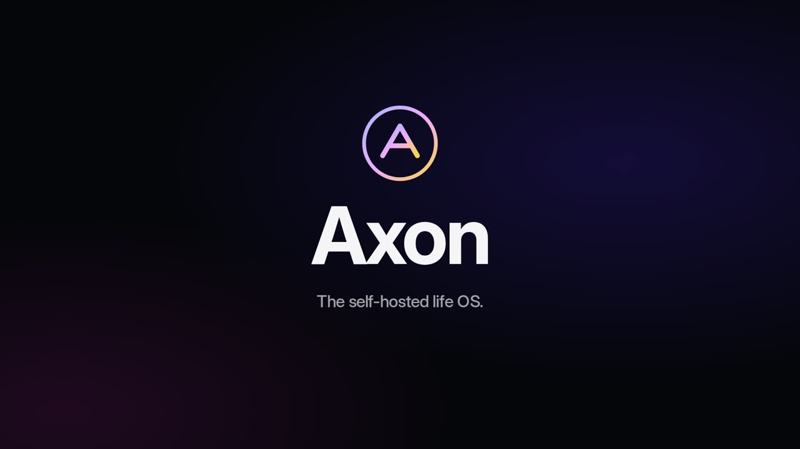](../web/static/teaser/axon-trailer-4k.mp4)

**[Voir la bande-annonce](../web/static/teaser/axon-trailer-4k.mp4)** (une minute, en musique ; aussi sur la page d’accueil quand la démo est ouverte).

| Aujourd’hui | Tâches | Notes |
|---|---|---|
| 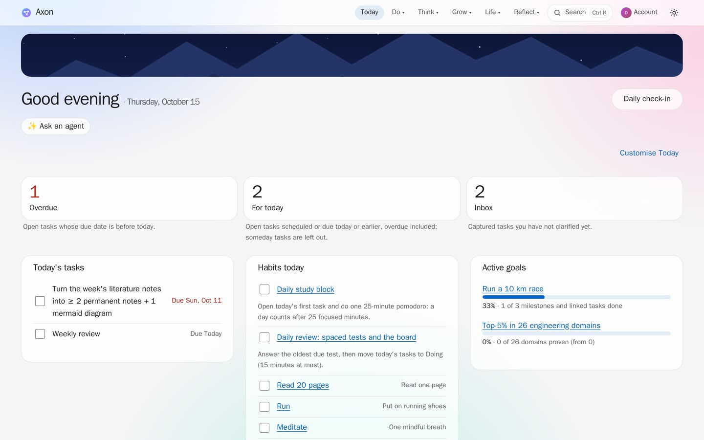 | 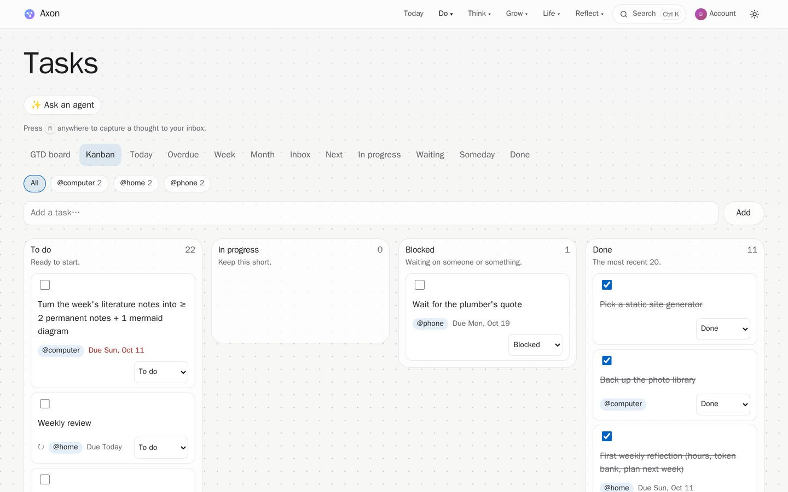 | 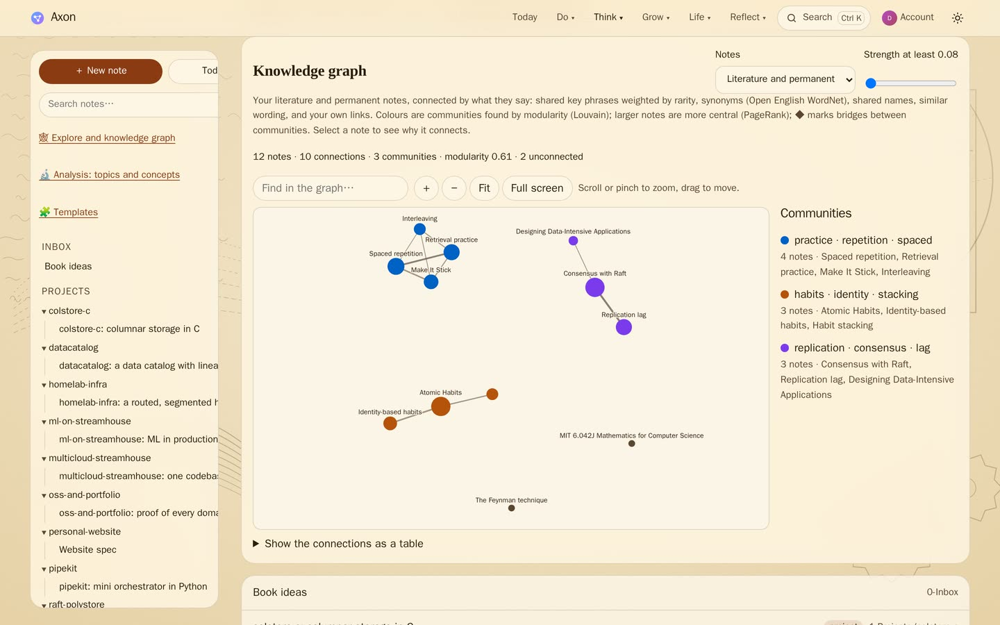 |

| Apprendre | Feuille de route | Concentration |
|---|---|---|
| 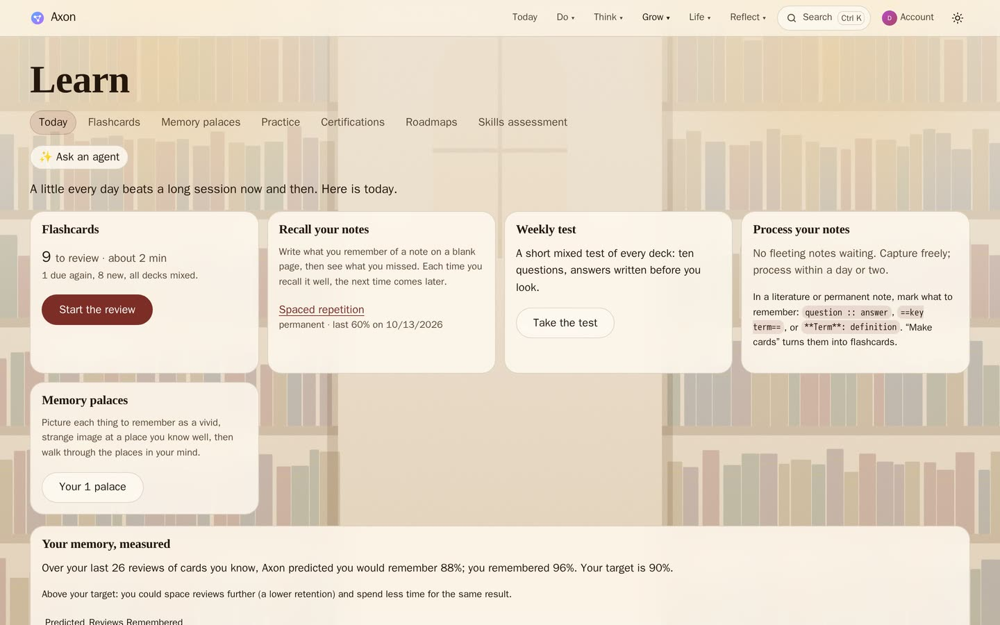 | 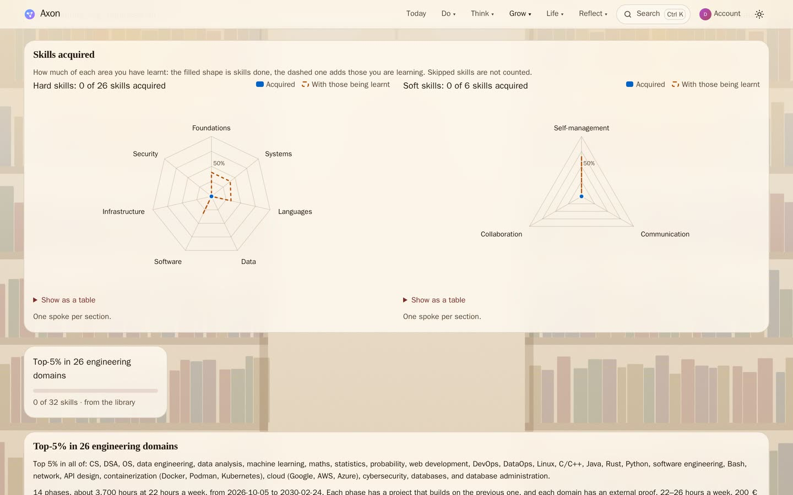 | 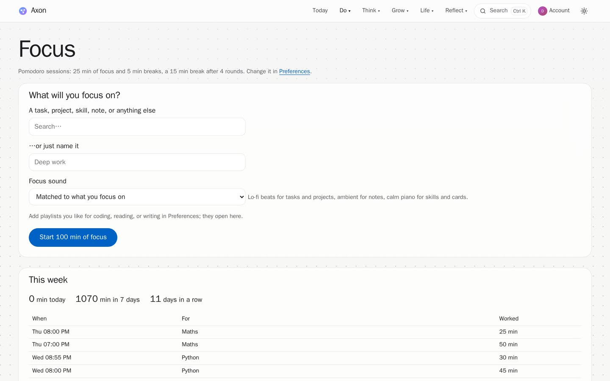 |

| Veille | Graphe de la veille | Santé |
|---|---|---|
| 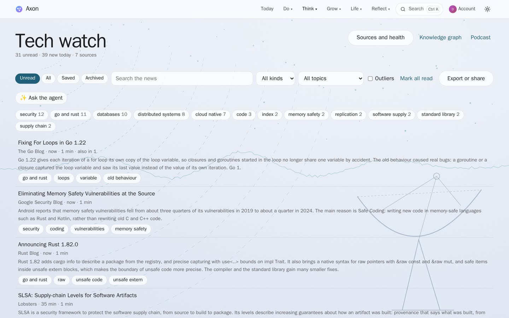 | 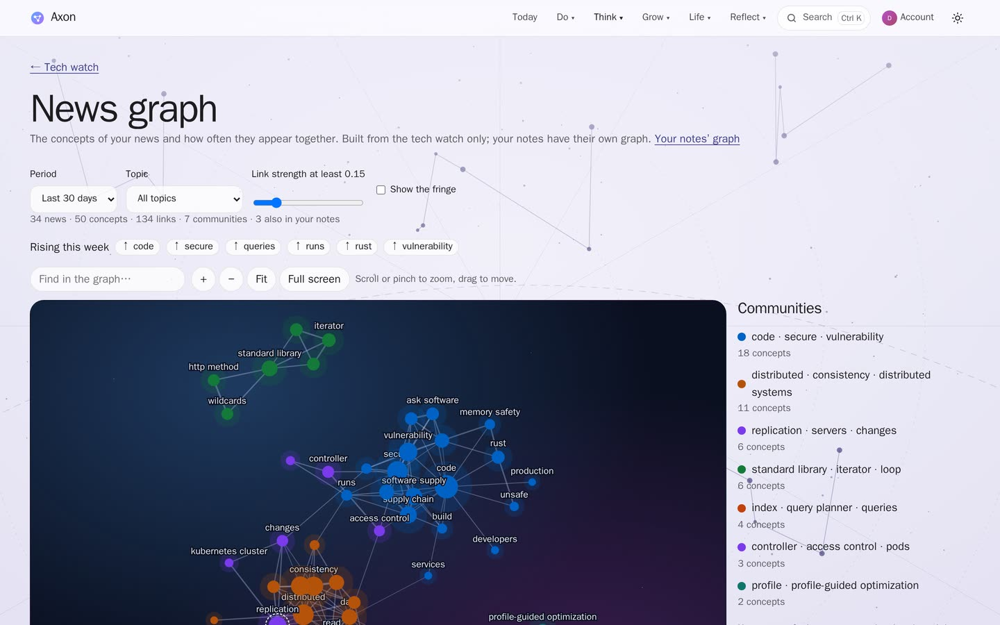 | 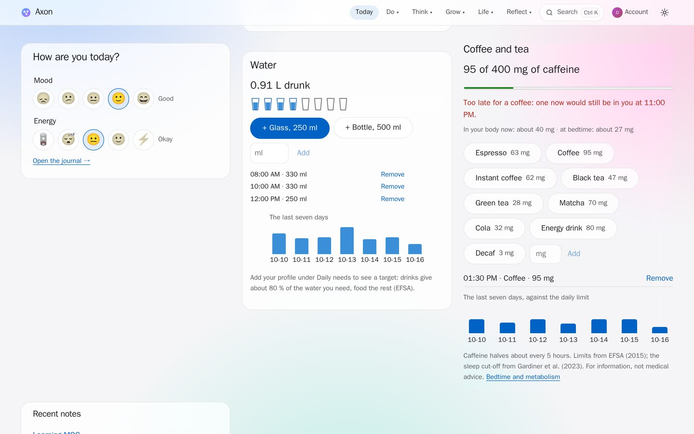 |

| Décisions | Collection | Habitudes |
|---|---|---|
| 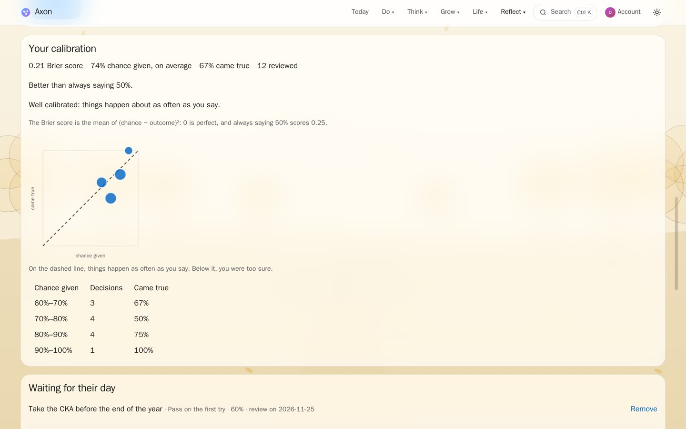 | 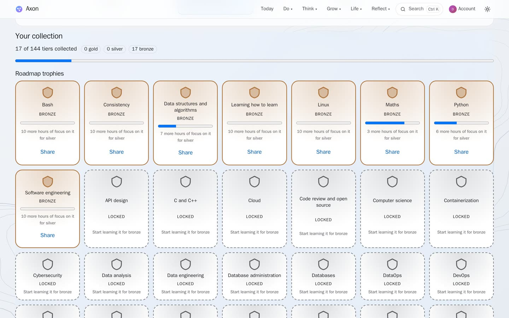 | 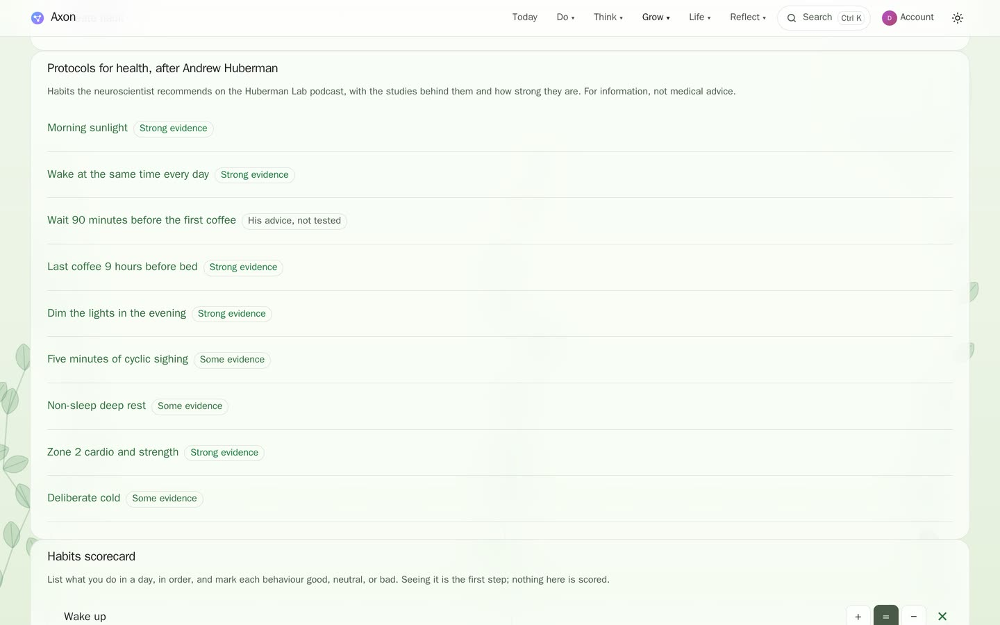 |

| Accueil | Aujourd’hui (sombre, téléphone) |
|---|---|
|  |  |

Capturées sur le compte de démonstration et ses données d’exemple. `make teaser` les reprend et refait la bande-annonce depuis un Axon en marche.

Direction visuelle

Grande typographie, espaces généreux, mode sombre, verre translucide sur des paysages intégrés (ADR 0010). Le mouvement doit clarifier l’état, comme un instrument bien fait, sans réclamer l’attention. Les préférences de mouvement réduit sont respectées, et chaque action reste utilisable sans animation.

