# The latest features (EP-114 to EP-125)

Captured on 16 October 2026 from the shared demo on srv-dev, in the light theme.

| | |
|---|---|
| **Decisions** (EP-114): the calibration of forecasts, Brier score and reliability chart 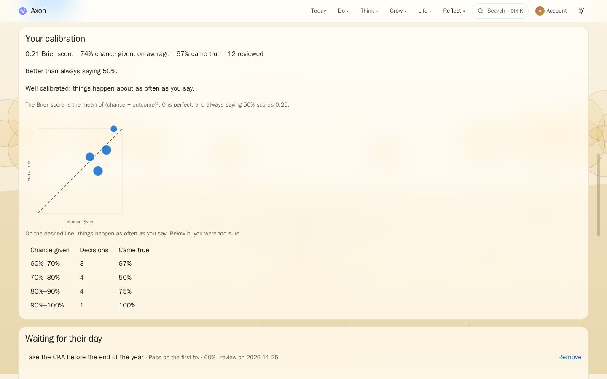 | **Search in the menu bar** (EP-115): content and pages, here "raft" 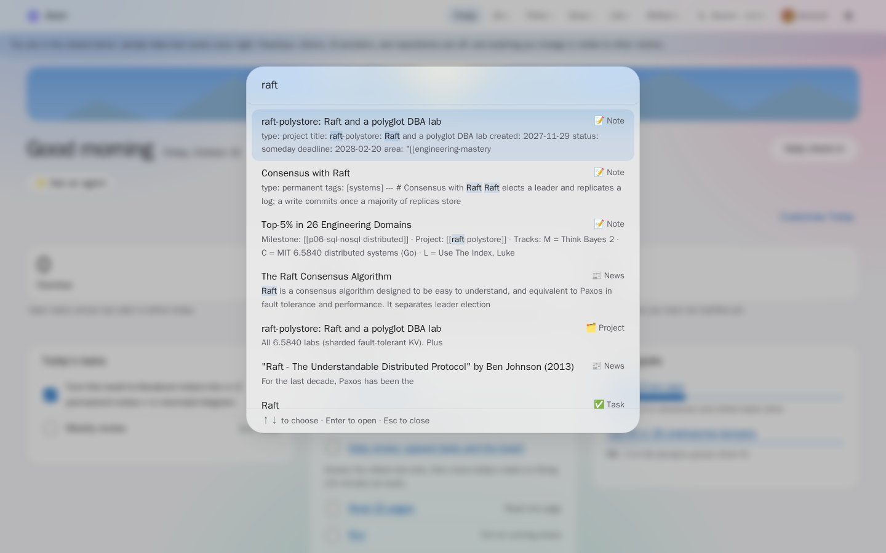 |
| **Checked items stay** (EP-116): a task done today, crossed out, with Done 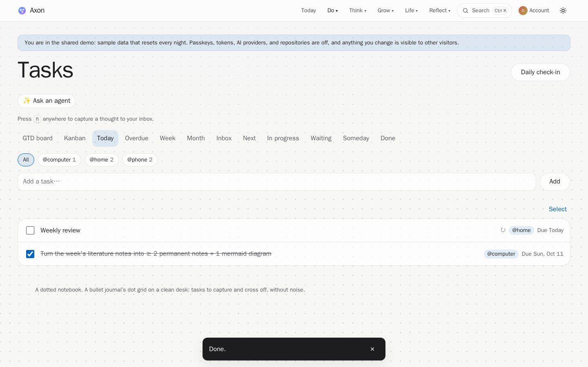 | **Coffee and tea** (EP-117): the day against the limit, the cut-off for sleep 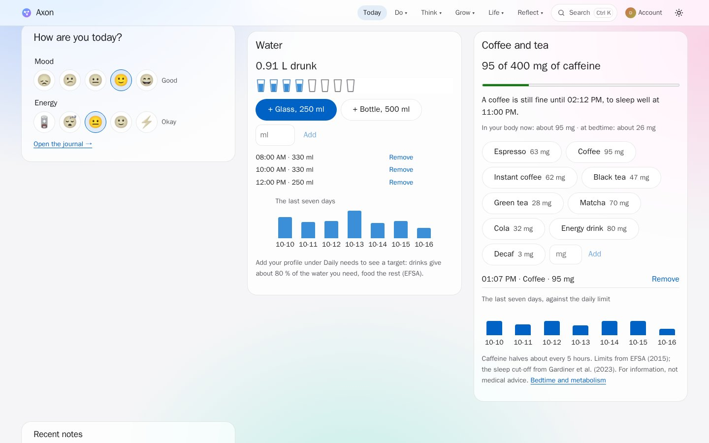 |
| **Huberman's protocols** (EP-118): what to do, why, the evidence, the sources 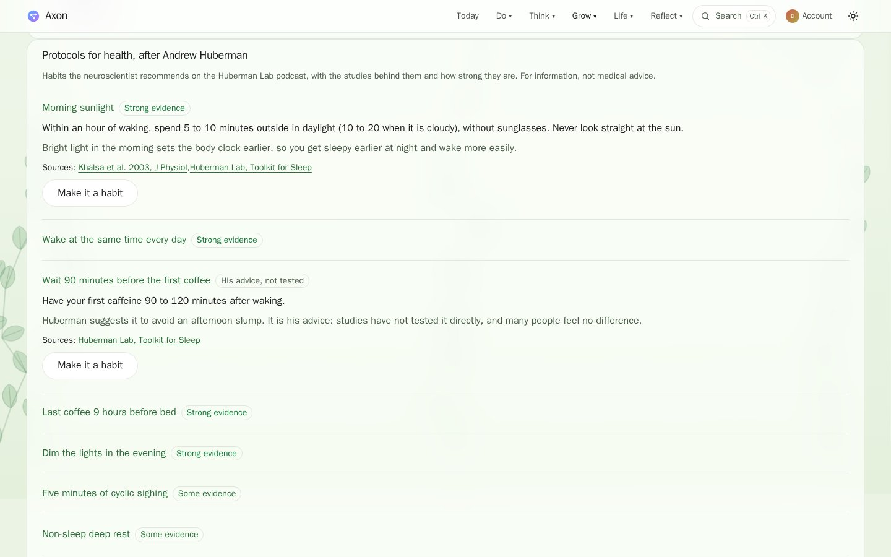 | **The collection** (EP-119): trophies in gold, silver, and bronze 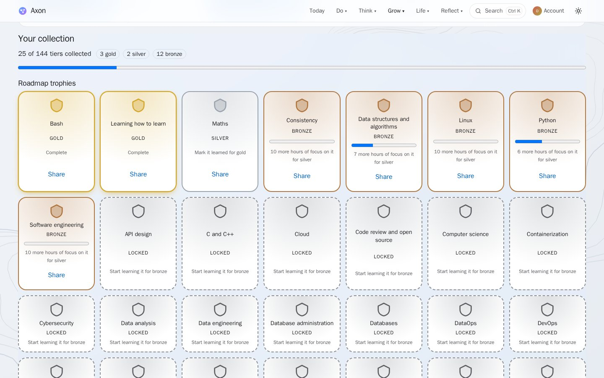 |
| **Share as a picture** (EP-121): the level, drawn on the device, to post 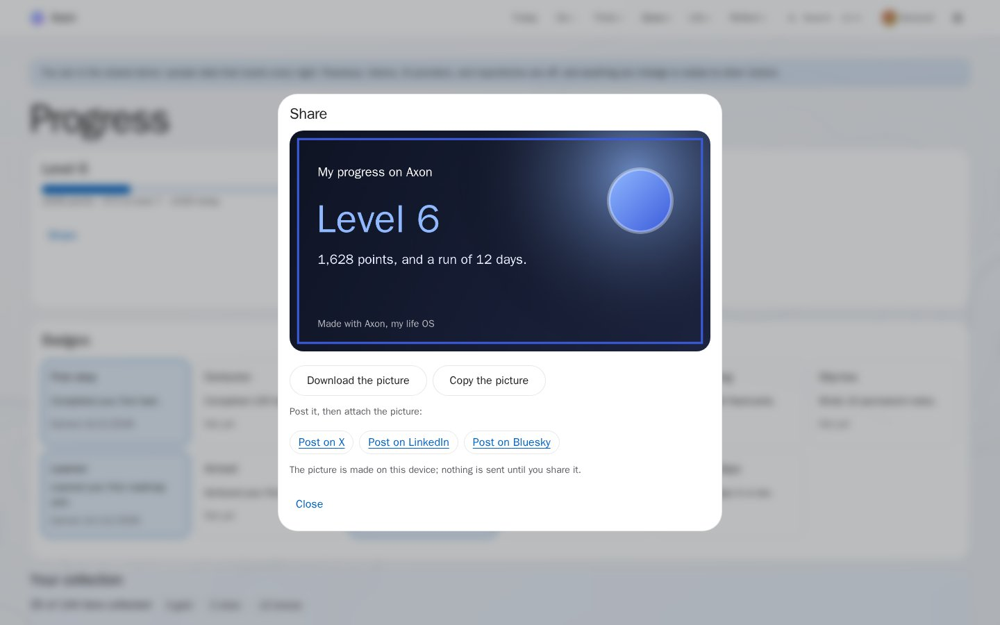 | **Invitations** (EP-120): links used once, into the household 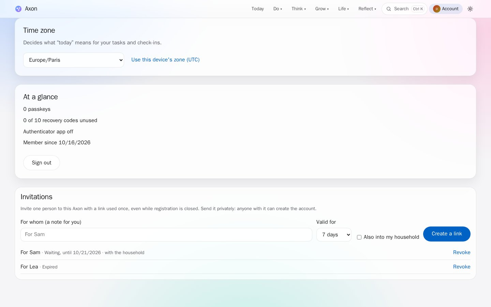 |
| **The news graph** (EP-122): "raft" found, its neighbours, its summary 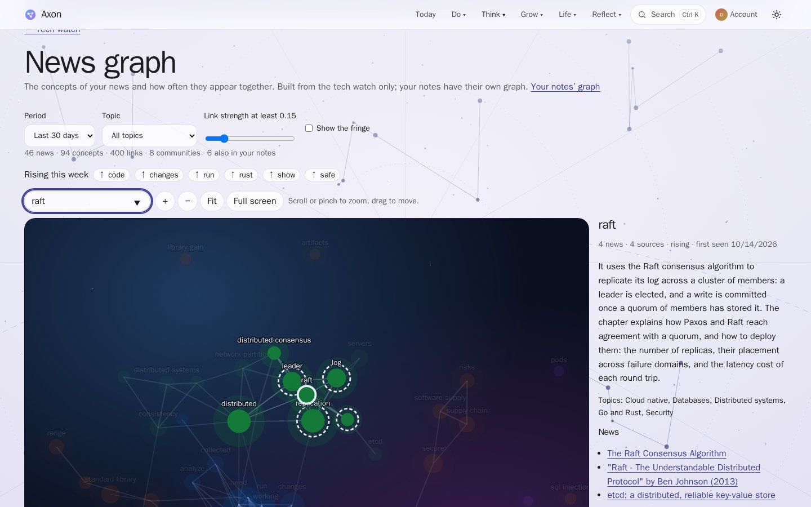 | **YouTube** (EP-123): Rob Pike's talk with its transcript from the captions 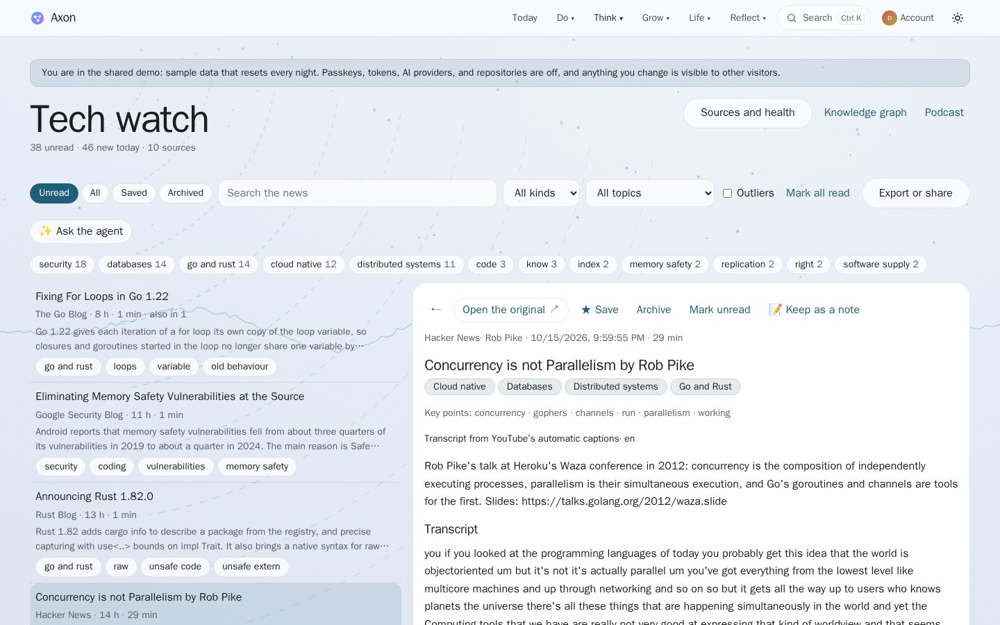 |
| **Podcasts** (EP-124): a Changelog News episode in the tech watch 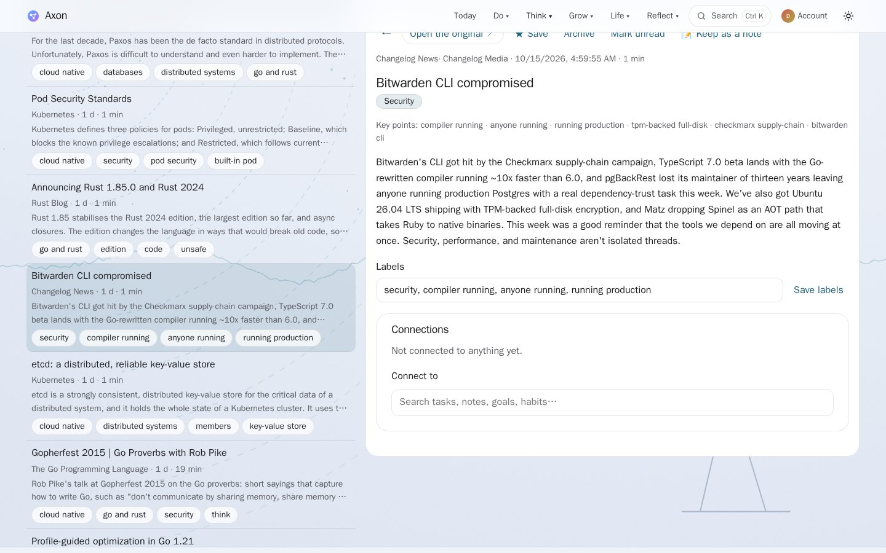 | **Audiobookshelf** (EP-124): the connection, explained in the demo 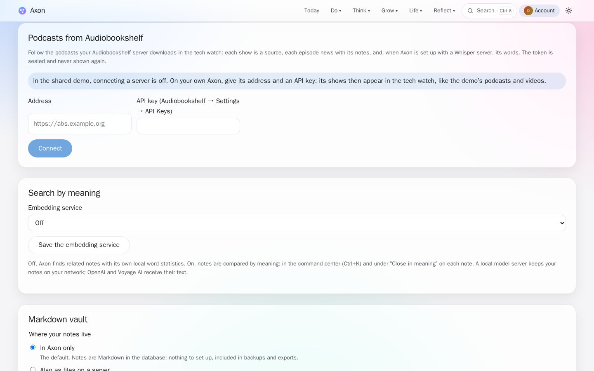 |
