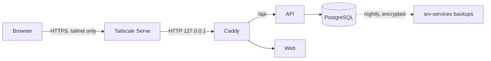

# Threat model: accounts, sessions, and data access

Scope: EP-04 (sign-in, sessions, authorization, export, erasure). Method: STRIDE per component. Revisit when a component in the diagram changes.

**Trust boundaries:** the tailnet (only enrolled devices reach Axon), the browser ↔ API boundary (untrusted input), the API ↔ database boundary, and the backup copy on another host.

## Assets

Session tokens, passkey private keys (never leave the user's device), recovery codes, TOTP secrets, the age key that decrypts backups and env files, and all personal data.

## Threats and mitigations

| # | STRIDE | Threat | Mitigation | Evidence |
|---|---|---|---|---|
| 1 | Spoofing | Password guessing / credential stuffing | No passwords: passkeys (phishing-resistant, origin-bound) | `TestRegisterSignInAndFirstUserOnly` |
| 2 | Spoofing | Brute-forcing recovery codes | 80-bit codes, single use, per-IP rate limit (10 burst, 1 per 6 s) | `TestSignInIsRateLimited`, `TestRecoveryCodes…` |
| 3 | Spoofing | Stolen recovery codes | Optional TOTP required alongside codes; codes reissuable; every use audited | `TestRecoveryCodes…RequireTOTPWhenEnabled` |
| 4 | Spoofing | Passkey from another account or site | WebAuthn checks RP ID, origin, challenge, signature, and that the credential belongs to the user handle | `TestPasskeyFromAnotherBrowserIsRejected` |
| 5 | Spoofing | Cloned authenticator | Sign-count regression (`CloneWarning`) rejects sign-in | code review |
| 6 | Spoofing | Strangers creating accounts | Registration closes after the first account (`AXON_REGISTRATION=first-user`), serialized by an advisory lock | `TestRegisterSignInAndFirstUserOnly` |
| 7 | Tampering | CSRF from another site | `SameSite=Lax` cookies, and every non-GET request needs a matching `Origin` (or `Sec-Fetch-Site: same-origin`) | `TestCrossSiteRequestsAreRejected` |
| 8 | Tampering | Session fixation | New random token at every sign-in; tokens stored only as SHA-256 hashes | code review |
| 9 | Tampering | Editing the audit trail | Trigger rejects `UPDATE` on `audit_events` | `TestAuditEventsAreAppendOnly` |
| 10 | Repudiation | "I didn't do that" | Audit events for sign-in, sign-out, factor, consent, export changes, with IP and user agent, visible to the owner | `TestConsentIsOffByDefaultAndAudited` |
| 11 | Information disclosure | User A reads user B's data | Every query filters by `user_id`; cross-user harness for every owned resource | `TestUsersCannotSeeOrChangeEachOthersData` |
| 12 | Information disclosure | Secrets or personal data in logs | Request logs carry only route pattern, status, duration, request ID; problem details never include internal errors | `TestRequestLogOmitsQueryHeadersAndPath` |
| 13 | Information disclosure | Stolen database dump | Token/code hashes only; TOTP secrets sealed with a key kept outside the database; backups age-encrypted | ADR 0005 |
| 14 | Information disclosure | XSS stealing sessions | `HttpOnly` cookies; CSP with nonces/hashes and no inline script; Svelte escapes output | response headers |
| 15 | Information disclosure | Exposure to the internet | Tailnet-only access, nothing published publicly | ADR 0004, port check |
| 16 | Denial of service | Oversized bodies, slowloris | 64 KiB body limit; server read/write/header timeouts | `app.limitBody`, `newHTTPServer` |
| 17 | Elevation of privilege | Using an expired or revoked session | Idle (7 d) and absolute (30 d) expiry checked on every request; revocation deletes the row | `TestSignOutEverywhere` |
| 18 | Elevation of privilege | Lockout by removing the last passkey | Last passkey cannot be removed | `TestLastPasskeyCannotBeRemoved` |

## Accepted risks

- The rate limiter is per process and per client IP; on a tailnet the set of possible clients is small. Revisit before any public deployment.
- A user agent string is stored per session so the owner can recognise devices; it is personal data and is exported and erased with the account.
- Losing `AXON_ENCRYPTION_KEY` disables TOTP for every account; passkeys and recovery codes keep working.
